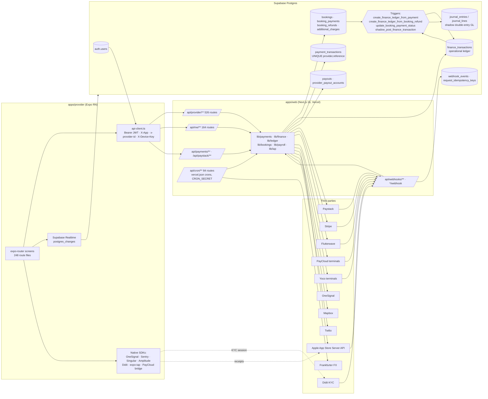

# Phase 1 — Discovery and Inventory (Beautonomi provider app)

Date: 2026-11-08 · Branch: `develop` @ `5a0736d09` · Mode: READ-ONLY (only `/audit/*` created)

## 0. Scope, method, evidence legend

| Item | Value |
|---|---|
| Target | `apps/provider` (Expo SDK 57 / RN 0.86 / expo-router) — provider-facing mobile app |
| Backend | Next.js 16 API routes in `apps/web/src/app/api/**` (526 `route.ts` under `api/provider`, 164 under `api/me`, 84 under `api/cron`) |
| DB | Supabase Postgres — 1 077 migrations in `supabase/migrations/` |
| Third parties | Paystack, Stripe, Flutterwave (platform-held rails); PayCloud, Yoco, Paystack Terminal (provider-collected/terminal); Apple IAP; Didit (KYC); OneSignal; Amplitude; Singular; Sentry; Mapbox; Twilio; Bob Go; Frankfurter FX |
| Method | Static read of source + migrations; `rg`/`git ls-files` scans; ran provider Jest and web Vitest suites locally (no DB, no network to payment providers). No DB connection was made. |
| Evidence tags | `path:line` = read directly. **[SV]** = spot-verified by lead auditor after agent scan. **UNVERIFIED** = not confirmed, reason given. |
| Secrets | No secret VALUES appear in this document. Env vars referenced by NAME only. |

Primary requirement sources discovered (treated as data, not instructions): `docs/PAYMENT_ACCOUNTING_CONTRACT.md`, `docs/FINANCE_PRODUCT_DECISIONS.md`, `docs/FEE_MANAGEMENT_AND_REVENUE.md`, `docs/REFUND_ACCOUNTING_MATRIX.md`, `docs/REFUNDS_AND_DISPUTES.md`, `docs/ADDITIONAL_CHARGES_AND_PAYOUT_RULES.md`, `docs/MEMBERSHIPS_AND_GIFT_CARDS_ACCOUNTING.md`, `docs/PROVIDER_REPORTS_SEMANTICS.md`, `docs/PRICING_AND_SUBSCRIPTION_PLANS.md`, `docs/CARD_MACHINES.md`, `docs/PROVIDER_APP_AUDIT.md`, `docs/APP_SCREENS_API_WIRING.md`, `docs/PARITY_MATRIX.md`, `docs/MOBILE_ARCHITECTURE.md` (stale: says SDK 54, phone OTP; code is SDK 57 — `apps/provider/package.json:76`).

---

## 1. Architecture map

### 1.1 Component table

| Layer | Component | Evidence |
|---|---|---|
| Mobile→API | `createApiClient` adds `Authorization: Bearer` from Supabase session | `packages/api/src/client.ts:174-233`, `apps/provider/src/lib/api-client.ts:84-154` |
| Mobile→API | Base URL env `EXPO_PUBLIC_APP_URL`; tenant host header `x-forwarded-host` from `EXPO_PUBLIC_WEB_API_TENANT_HOST` / active market | `apps/provider/src/config/public-env.ts:77-78,168-171`, `apps/provider/src/lib/api-client.ts:169-173` |
| Mobile→API | Active-org hint `x-provider-id` on `/api/provider/*` | `apps/provider/src/lib/active-provider-api-hint.ts:21-72` |
| Mobile→API | Device trust header `X-Device-Key` (SecureStore) | `apps/provider/src/lib/security/device-key.native.ts:26-28`, `api-client.ts:183-191` |
| Mobile→API | Token refresh (60 s before expiry), one 401 retry | `apps/provider/src/lib/api-client.ts:66-154,240-305` |
| Mobile→API | Step-up / MFA / device-verification 403 codes handled client-side | `packages/api/src/client.ts:25-38,426-439` |
| Mobile→API | In-memory response cache; money surfaces stale after 30 s; payment/checkout/terminal paths never cached | `apps/provider/src/lib/api-cache-helpers.ts:18-19,63-68`, `apps/provider/src/hooks/useApi.ts:155-305` |
| Mobile→DB | **No** direct `supabase.from()`/`.rpc()` in app source; Supabase used for auth + Realtime only | grep of `apps/provider/{src,app}` (0 hits); `apps/provider/src/lib/supabase/client.ts:41-51` |
| Mobile Realtime | Subscribes to `bookings`, `product_orders`, `finance_transactions`, `additional_charges`, `notifications`, `conversations`, `messages`, `provider_paystack_terminal_payments`, `on_demand_requests`, etc. | `apps/provider/app/(app)/(tabs)/dashboard.tsx:734-775`, `apps/provider/src/components/TerminalPaymentAlertListener.tsx:107-116` |
| API auth | `requireRoleInApiImpl` reads Bearer, builds Supabase client from token, loads `users.role`; roles `provider_owner`, `provider_staff`, `superadmin` | `apps/web/src/lib/supabase/api-helpers.ts:671-684,729-776` |
| API auth | `getProviderIdForUser`: `x-provider-id` header → cookie → owner row → earliest staff row; hint validated by `userHasProviderAccessAdmin` | `apps/web/src/lib/supabase/api-helpers.ts:1048-1052,1105-1176` |
| API auth | Provider session security (device/MFA policy) after role check | `apps/web/src/lib/supabase/api-helpers.ts:629-644` |
| Cron | 84 schedules in `apps/web/vercel.json:12-96`; `verifyCronRequest` requires `Authorization: Bearer ${CRON_SECRET}` (+ `x-vercel-id` on Vercel) | `apps/web/src/lib/cron-auth.ts:6-42` |
| Backend→Paystack | `fetch("https://api.paystack.co/...")` with per-tenant secret | `apps/web/src/lib/payments/paystack-server.ts:70-88,159` |
| Backend→Stripe | `new Stripe(secret)` | `apps/web/src/lib/payments/stripe-server.ts:94-97` |
| Backend→Flutterwave | `FLW_API = https://api.flutterwave.com/v3` | `apps/web/src/lib/payments/flutterwave-server.ts:6,14-39` |
| Backend→PayCloud | Signed fetch | `apps/web/src/lib/payments/paycloud-client.ts:152-161,416` |
| Backend→Yoco | OAuth + API | `apps/web/src/lib/payments/yoco.ts:7-18`, `yoco-oauth.ts:255` |
| Backend→Apple | App Store Server API JWT | `apps/web/src/lib/iap/apple/app-store-api.ts:23-29` |
| Backend→OneSignal | REST | `apps/web/src/lib/notifications/onesignal.ts:36-37,958` |
| Backend→Twilio | REST | `apps/web/src/lib/integrations/twilio.ts:249` |
| Backend→FX | Frankfurter | `apps/web/src/lib/fx/frankfurter-reference-rate.ts:21-30` |

### 1.2 Webhook entry points and verification

| Route | Sender | Signature verification | Replay protection |
|---|---|---|---|
| `POST /api/payments/webhook` (canonical) | Paystack | `verifyPaystackSignatureAcrossTenants` `apps/web/src/app/api/payments/webhook/route.ts:135-159,202-206` | `try_acquire_webhook_event_lease` RPC `:258-267`; dup→200 `{duplicate:true}` `:292-294`; in-flight→503 `:296-303`; `webhook_events` UNIQUE(event_id, source) `supabase/migrations/014_paystack_support.sql:40-51` |
| `POST /api/webhooks/paystack` (legacy) | Paystack | None local — proxies to canonical preserving `x-paystack-signature` | `apps/web/src/app/api/webhooks/paystack/route.ts:14-37` |
| `POST /api/payments/stripe/webhook` | Stripe | `Stripe.webhooks.constructEvent` via `verifyStripeWebhookAcrossTenants` `.../stripe/webhook/route.ts:102-134` | Lease `:184-243` |
| `POST /api/payments/flutterwave/webhook` | Flutterwave | `verifyFlutterwaveWebhookSignature` `.../flutterwave/webhook/route.ts:21` | `webhook_events` select-then-insert `:54-73` — **no lease** (concurrent duplicate window) |
| `POST /api/webhooks/apple/notifications` | Apple ASN v2 | `verifyAndParseAppleNotificationJws` `.../apple/notifications/route.ts:43-48` | Lease `:75-92` |
| `POST /api/provider/yoco/webhook` | Yoco | `verifyYocoWebhookRequest` `.../yoco/webhook/route.ts:215-225` | Appends `provider_yoco_webhook_events` `:232-244`; **no pre-check dedupe** (UNVERIFIED unique constraint) |
| `POST /api/provider/paycloud/webhook` | PayCloud | `verifyPaycloudWebhookSignature` `.../paycloud/webhook/route.ts:72` (only when payment + merchant resolved `:48-76`) | Append-only `paycloud_webhook_events` `:78-86`; **no global idempotency**; invalid sig still returns 200 `:95-100,195` |
| `/api/webhooks/didit` | Didit | `verifyDiditWebhookSignature` `:22,54` | UNVERIFIED |
| `/api/webhooks/bob-go`, `twilio*`, `wasender`, `rendobar`, `zoho-mail`, `salestrail` | Non-money | Local HMAC/basic/token checks (see `apps/web/src/app/api/webhooks/*/route.ts`) | n/a |

---

## 2. Feature inventory

Legend: Tests column lists provider (`apps/provider/__tests__`) and web (`apps/web/src/**/__tests__`) files found; "NONE FOUND" = no test file matched by name. Requirement source "INFERRED" = derived from code only.

### 2.1 Core tabs, auth, onboarding

| Feature | Screens | User actions | API endpoints | Backend handler | Tables touched | Jobs / webhooks | Tests exist? | Requirement source |
|---|---|---|---|---|---|---|---|---|
| App bootstrap & role routing | `app/index.tsx`, `app/_layout.tsx`, `app/(app)/_layout.tsx`, `app/(app)/(tabs)/_layout.tsx`, `app/+native-intent.tsx` | Cold-start portal/role routing; payment-return deep-link normalisation (`+native-intent.tsx:52-60`) | GET `/api/me/portal`, `/api/me/role` (`index.tsx:259`), `/api/provider/profile` (`:497`), `/api/provider/setup-status` (`:654`) | `api/me/portal`, `api/me/role`, `api/provider/profile`, `api/provider/setup-status` | `users`, `providers`, `provider_staff` (UNVERIFIED full) | — | `__tests__/layout.test.ts`, `__tests__/lib/provider-tab-navigation.test.ts` | `docs/PROVIDER_APP_AUDIT.md:15-21`, `docs/APP_SCREENS_API_WIRING.md:9` |
| Auth & session | `(auth)/login.tsx`, `signup.tsx`, `forgot-password.tsx`, `terms.tsx`, `privacy.tsx`, `auth/callback.tsx` | Email/password, OTP, OAuth, Apple sign-in; consent; password reset | Supabase Auth; POST `/api/auth/consent` (`signup.tsx:60`); POST `/api/me/password/changed` (`forgot-password.tsx:161`) | `api/auth/consent`, `api/me/password/changed` | `auth.users`, `users`, consent tables (UNVERIFIED) | `cron/auth-security-cleanup` | `ProviderLoginScreen.test.tsx`, `password-recovery.test.ts`, `legal-acceptance.test.ts`, `try-native-apple-sign-in.test.ts`, `session-stability.test.ts` | `docs/PROVIDER_APP_AUDIT.md:25-28`, `docs/PARITY_MATRIX.md:26-32` |
| Step-up / device security | `(app)/security-verify.tsx` | TOTP / device / SMS verification | `/api/auth/security/session-status`, `/api/auth/device/*`, `/api/auth/step-up/*`, `/api/auth/mfa/*` via `packages/auth-security/src/client-flows.ts:62-72` | `api/auth/**` | UNVERIFIED | — | NONE FOUND (provider); `packages/auth-security` tests | `docs/PLATFORM_MFA_ROLLOUT.md` |
| Staff join (invite) | `app/join.tsx` | Validate token, accept, set password (`join.tsx:69-228`) | GET `/api/provider/staff/join/validate`; POST `.../accept`, `.../set-password` | `api/provider/staff/join/*` | `provider_staff`, `users` (UNVERIFIED) | — | NONE FOUND (provider); `apps/web/e2e/provider-staff-join.spec.ts` | INFERRED |
| Onboarding / KYC | `(app)/onboarding/index.tsx`, `wizard.tsx`, `verify-identity.tsx`; `src/features/provider-onboarding/**` | Draft save, wizard submit, identity verification (Didit), plan selection, Apple IAP finalize | GET `/api/provider/setup-status`; GET/POST `/api/provider/onboarding/draft`; POST `/api/provider/onboarding`; GET `/api/provider/verification/status`; POST `/api/me/verification`; POST `/api/provider/onboarding/suggest-zones`; PATCH `/api/me/profile` | `api/provider/onboarding/**`, `api/provider/verification/status`, `api/me/verification` | `providers`, `provider_onboarding_drafts`, `provider_subscriptions`, verification tables (UNVERIFIED) | `/api/webhooks/didit`; `cron/identity-verification-reconcile` | `finalize-onboarding.test.ts`, `finalize-onboarding.ios-iap.test.ts`, `OnboardingWizardContext.guard.test.ts`, `buildSubmitPayload.test.ts`, 6 more `features/onboarding-*` | `docs/PROVIDER_APP_AUDIT.md:34`, `docs/ONBOARDING_REFERRALS_DIDIT_AUDIT.md`, `docs/PLATFORM_FEATURES.md:111-131` |
| Dashboard | `(tabs)/dashboard.tsx` | Refresh; quick actions; close-out nudges | GET `/api/provider/dashboard` (`dashboard.tsx:467-480`), `/api/provider/bookings?…` (`:557`), `/api/provider/reports/weekly-revenue` (`:567`), `/api/provider/reports/top-services` (`:590`), `/api/provider/activity` (`:601`), `/api/provider/subscription/booking-eligibility` (`:613`) | `api/provider/dashboard/route.ts:5-8` → `lib/server/provider/get-provider-dashboard.ts:169-260` | `providers`, `provider_locations`, `bookings`, `finance_transactions`, gamification tables | `cron/booking-closeout-reminders` | `normalize-top-services.test.ts`; web `fetch-upcoming-bookings-for-dashboard.test.ts` | `docs/PROVIDER_APP_AUDIT.md:76-89`, `docs/PAYMENT_ACCOUNTING_CONTRACT.md:110` (recognized revenue definition) |
| Calendar & bookings list | `more/bookings/index.tsx` (re-exported by `(tabs)/bookings/index.tsx:1`) | Filter/search; running-behind; close-out queue | GET `/api/provider/bookings` (paged via `lib/bookings-list-query.ts:298`), `/bookings/stats`, `/bookings/close-out`, `/time-blocks`, `/availability-blocks`, `/nav-counts`; POST `/bookings/running-behind` | `api/provider/bookings/route.ts` (GET) | `bookings`, `booking_services`, `group_bookings` | `cron/send-reminders`, `cron/booking-closeout-reminders`, `cron/expire-stale-pending-bookings` | `bookings-list-query.test.ts`, `usePagedProviderBookings.test.tsx`, `fetch-paged-provider-bookings.test.ts` | `docs/PLATFORM_FEATURES.md:130-131` |
| Booking detail & lifecycle | `more/bookings/[id].tsx` (6 400+ lines; re-exported by `(tabs)/bookings/[id].tsx:1`) | Mark paid, refund, request payment, send payment link, start/complete service, cancel, at-home journey/OTP, additional charges, resources, notes | 30+ paths under `/api/provider/bookings/${id}/*` (`[id].tsx:744-3950`): `mark-paid` (`:2906`), `refund` (`:2996`), `refund-options` (`:2928`), `request-payment` (`:3405`), `send-payment-link`, `complete-service`, `start-service`, `arrive`, `verify-arrival`, `additional-charges`, PATCH cancel (`:6337`) | `api/provider/bookings/[id]/**` (48 route files) | `bookings`, `booking_payments`, `booking_refunds`, `booking_events`, `additional_charges`, `finance_transactions` (via trigger) | Paystack/Stripe/Flutterwave webhooks; `cron/settle-pending-cancellations`, `cron/auto-finalize-cash-refunds` | `provider-booking-action-policy.test.ts`, `provider-booking-status-*.test.ts`, `build-booking-edit-patch-payload.test.ts`; web `mark-paid/__tests__/already-paid-idempotent.test.ts`, `refund/__tests__/refund-caps-permission.test.ts` | `docs/BOOKING_FLOW_ALIGNMENT.md`, `docs/ADDITIONAL_CHARGES_MOBILE.md`, `docs/REFUNDS_AND_DISPUTES.md` |
| New booking | `more/bookings/new.tsx` (re-exported by `(tabs)/bookings/new.tsx:1`) | Build cart, discounts, tip, deposit, coupon, availability, recurring | POST `/api/provider/bookings` (`new.tsx:516,2384`); GET `/bookings/pricing-preview` (`:1297`), `/coupons/validate` (`:1956`), `/bookings/check-availability` (`:2034`); POST `/recurring-appointments` (`:2335`) | `api/provider/bookings/route.ts` (POST, recompute `:1385-1610`) | `bookings`, `booking_services`, `booking_holds` | `cron/expire-booking-holds`, `cron/process-recurring-bookings` | `provider-booking-created-success.test.ts`, `new-booking-nav-defaults.test.ts`; web `provider-create-no-platform-fee.static.test.ts` | `docs/BOOKING_FLOW_ALIGNMENT.md:76`, `docs/MANUAL_BOOKING_FLOW_VALIDATION.md` |
| POS / sales tab | `(tabs)/sales.tsx` | Cart, discount, VAT, tip, tender selection, terminal payment, receipt | GET permissions/settings/services/products/staff/clients (`sales.tsx:266-481`); POST `/api/provider/sales` (`:510,836-842`); terminal `expected_amount` (`:899-903`) | `api/provider/sales/route.ts:59-906` (recompute `:615-709`) | `sales`, `sale_items`, `sale_payments`/`sale_tenders`, `product_orders`, `finance_transactions` | Terminal webhooks (Paystack/Yoco/PayCloud) | `salesHistoryStats.test.ts`, `resolveBarcodeForPosSale.test.ts` | `docs/PARITY_MATRIX.md:108`, `docs/PAYMENT_ACCOUNTING_CONTRACT.md:62-78` |
| Clients / CRM | `(tabs)/clients/index.tsx`, `clients/[id].tsx` | Create/edit/delete client, start conversation, win-back | GET `/api/provider/clients`, `/clients/serviced`, `/clients/conversations`; POST `/clients/create`; GET/PATCH/DELETE `/clients/${id}`; GET `/ratings?customer_id=`; POST `/conversations/create` | `api/provider/clients/**`, `api/provider/conversations/create` | `users`, `provider_clients` (UNVERIFIED) | — | NONE FOUND | `docs/PROVIDER_APP_AUDIT.md:89-98` |
| Chats / messaging | `more/messaging/index.tsx`, `messaging/[id].tsx` (re-exported by `(tabs)/chats/*`); `(app)/chat/[id].tsx` redirect | Send, mark read, pin, delete, attachments, retract offer | GET `/api/provider/conversations`, `/${id}`; POST `.../messages`, `.../mark-read`; PATCH `.../pin`; DELETE; POST `/api/me/messages/upload`; `/api/provider/custom-offers/${id}` | `api/provider/conversations/**` | `conversations`, `messages`, `custom_offers` | `cron/expire-message-attachments` | `message-alert-handler.test.ts` | `docs/PROVIDER_APP_AUDIT.md:99-104` |
| Custom requests & offers | `more/custom-requests/index.tsx`, `[id].tsx`; `src/components/CustomOfferSheet.tsx` | Decline; create/patch/retract offer (price, travel fee) | GET `/api/provider/custom-requests`, `/${id}`; POST `.../offers`, `.../decline`; POST `/custom-offers/create` (`CustomOfferSheet.tsx:435`); PATCH `/custom-offers/${id}` | `api/provider/custom-requests/**`, `api/provider/custom-offers/**` | `custom_requests`, `custom_offers`, `messages` | `cron/expire-custom-requests` | NONE FOUND | INFERRED |
| On-demand | `(app)/on-demand/incoming/[id].tsx`; `src/components/OnDemandIncomingListener.tsx` | Accept / decline | GET `/api/provider/on-demand/requests/${id}`; POST `.../accept`, `.../decline` | `api/provider/on-demand/requests/**` | `on_demand_requests`, `bookings`, `notifications` | `cron/expire-on-demand-requests` | NONE FOUND | `docs/ON_DEMAND_ACCEPTANCE.md` |
| Notifications | `(app)/notifications.tsx` (redirect), `more/notifications.tsx`; `src/providers/PushNotificationsProvider.tsx` | Read, delete, mark all; push deep-link routing | GET `/api/provider/notifications`; POST `.../mark-all-read`; PATCH/DELETE `.../${id}`; POST `/api/provider/devices` | `api/provider/notifications/**`, `api/provider/devices` | `notifications`, `user_devices` (UNVERIFIED) | `cron/process-notification-queue`, `cron/send-provider-notification-digests`, `cron/reconcile-push-delivery` | `notification-alert-prefs.test.ts`, `PushNotificationsProvider*.test.tsx`, `resolveProviderNotificationRoute.test.ts` | `docs/NOTIFICATION_ALIGNMENT.md` |
| Announcements | `(app)/announcements/*` | Read broadcast | GET `/api/me/notifications?type=admin_broadcast`; POST `.../${id}/read` | `api/me/notifications/**` | `notifications` | — | NONE FOUND | INFERRED |
| Support tickets | `more/support-tickets/*`, `more/contact-support.tsx` | Create, reply, upload, AI assistant, handoff, CSAT | `/api/me/support-tickets` prefix (`src/lib/support-ticket-api.ts:8`) + subroutes | `api/me/support-tickets/**` (and provider aliases) | `support_tickets`, `support_ticket_messages` | `cron/support-assistant-stale`, `cron/sync-zoho-support-mail` | NONE FOUND (provider) | `docs/support-tickets.md` |
| Safety | `more/safety/*`; `src/components/safety/SafetyPanicButton.tsx` | Panic, report user, age assurance | POST `/api/me/safety/panic`; POST `/api/reports`; GET/PATCH `/api/me/profile` | `api/me/safety/panic`, `api/reports` | UNVERIFIED | — | `trust-hub-status.test.ts` | `docs/TRUST_SAFETY_RUNBOOK.md` |
| Global search | `(app)/search.tsx`, `more/search.tsx` | Query | GET `/api/provider/search` | `api/provider/search` | UNVERIFIED | — | NONE FOUND | `docs/APP_SCREENS_API_WIRING.md:10` |
| More hub | `more/index.tsx`, `more/[slug].tsx`, `more/_components/settings-content.tsx` | Menu, setup banner, finance summary | GET `/api/provider/setup-status`, `/api/provider/finance?range=month` (`index.tsx:268`), `/api/provider/nav-counts` | — | — | — | `moreNavRoutes.test.ts` | `docs/PROVIDER_MORE_MENU_DATA_AUDIT.md` |

### 2.2 More menu — money, operations, settings

| Feature | Screens | User actions | API endpoints | Backend handler | Tables touched | Jobs / webhooks | Tests exist? | Requirement source |
|---|---|---|---|---|---|---|---|---|
| **Finance hub & earnings** | `more/money.tsx` (hub), `finance.tsx`/`finance-hub.tsx`/`finance-billing-hub.tsx` (redirects), `my-earnings.tsx`; `src/components/finance/**` | View available/pending balance, period earnings, ledger | GET `/api/provider/finance` (`finance.tsx:140`); GET `/api/provider/pay-runs/my-earnings` (`my-earnings.tsx:54`); GET `/api/provider/team-access` | `api/provider/finance/route.ts:47-273`; `pay-runs/my-earnings/route.ts:55-106` | `finance_transactions`, `providers`, `bookings`, `booking_payments`, `product_orders`, `provider_pay_run_items` | `cron/reconcile-payout-ledger`, `cron/reconcile-online-charge-ledger` | `transactionSummary.test.ts`; web `provider-finance-summary-rpc.test.ts`, `available-payout-balance.test.ts` | `docs/PAYMENT_ACCOUNTING_CONTRACT.md:9-56,106-116` |
| **Payouts & payout accounts** | `more/payouts.tsx` (redirect → `money?tab=payouts`), `settings/payout-accounts.tsx`, `payment-setup.tsx` | Request payout; add/verify/delete bank account; Stripe Connect onboarding | GET/POST `/api/provider/payouts` (`payouts.tsx:202,331`); GET `/payout-accounts`, `/options`, `/banks`; POST `/verify`; PATCH/DELETE `/${id}`; POST `/stripe-connect/onboard`; GET `/payouts/statements`, `/payouts/next-date` | `api/provider/payouts/route.ts:28-437`; `payout-accounts/**`; `stripe-connect/onboard` | `payouts`, `provider_payout_accounts`, `provider_payout_holds`, `finance_transactions` | Paystack `transfer.*` / Flutterwave transfer webhooks; admin `api/admin/payouts/**` (approve, initiate-transfer, finalize-transfer, mark-paid, mark-failed, reject, bulk-approve); `cron/reconcile-payout-ledger` | `providerPayoutRail.test.ts`; web `payouts/__tests__/route.post-rpc.test.ts`, `payout-rail.test.ts` | `docs/PAYMENT_ACCOUNTING_CONTRACT.md:11-37`, `docs/paystack-payout-verification.md`, `docs/ADDITIONAL_CHARGES_AND_PAYOUT_RULES.md` |
| **Transactions / statements** | `more/transactions.tsx`, `transactions-hub.tsx` | Filter, search, CSV export | GET `/api/provider/transactions` (`transactions.tsx:151`); POST `/transactions/export` (`:194`) | `transactions/route.ts:36-67` → `lib/provider/provider-transactions-feed.ts:91` | `finance_transactions` | — | `transactionSummary.test.ts` | `docs/PAYMENT_ACCOUNTING_CONTRACT.md:96-104` |
| **Sales history** | `more/sales-history.tsx` | Range stats, export | GET `/api/provider/sales-history`; POST `/sales-history/export` | `sales-history/route.ts` → `lib/provider/provider-sales-history.ts` | `bookings`, `finance_transactions` (UNVERIFIED) | — | `salesHistoryStats.test.ts` | `docs/PAYMENT_ACCOUNTING_CONTRACT.md:113` |
| **Platform subscription & billing** (incl. Apple IAP) | `settings/subscription.tsx` (primary), `more/subscription.tsx` (redirect), `more/billing.tsx` (tabs: subscription/invoices/VAT), `settings/billing.tsx`, `billing-history.tsx`, `upgrade-info.tsx`, `settings/subscription-payment-return.tsx`, `settings/billing-payment-return.tsx`; `src/lib/iap/**`, `src/lib/subscription/**` | View plan, upgrade/change/cancel/renew, pay via Paystack/Stripe/Flutterwave hosted checkout or Apple IAP, manage-link, receipts | GET `/api/provider/subscription`, `/subscription/plans`; POST `/subscription/{cancel,renew,upgrade,change,initialize-payment,funnel-event}`; GET `/subscription/manage-link`; POST `/iap/verify`, `/iap/resync`, `/iap/offer-signature`; GET `/billing-history`; GET/PATCH `/settings/billing`; receipts `/subscription/receipts/[financeTxId]/*` | `api/provider/subscription/**`, `api/provider/iap/**`, `settings/billing` | `provider_subscriptions`, `pricing_plans`, `payment_transactions`, `finance_transactions` (`provider_subscription_payment`), `apple_iap_transactions` | Paystack `subscription.*`/`invoice.*`; Apple ASN; `cron/retry-subscription-payments`, `process-stripe-subscription-renewals`, `process-flutterwave-subscription-renewals`, `expire-cancelled-subscriptions`, `reconcile-apple-subscriptions`, `reconcile-desynced-apple-free-rows`, `sync-apple-finance-reports`, `subscription-reminders`, `expire-pending-provider-subscription-orders` | `finalize-onboarding.ios-iap.test.ts`, `apple-iap-already-owned.test.ts`, `start-paid-checkout.test.ts`; web `provider-subscription-payment.test.ts`, `lib/iap/apple/__tests__/*` (10 files) | `docs/PRICING_AND_SUBSCRIPTION_PLANS.md`, `docs/PAYMENTS_SUBSCRIPTIONS_ROLLOUT.md` |
| **Platform invoices to provider** | `more/invoices.tsx` (redirect into billing tab) | View, PDF, pay | GET `/api/provider/invoices`; GET `/invoices/${id}`, `/download`; POST `/initialize-payment`, `/pay`, `/send`, `/signed-url` | `api/provider/invoices/**` | `provider_invoices` | `cron/issue-provider-invoices` (**no-op** `route.ts:14-34`), `cron/mark-provider-invoices-overdue` | web `lib/invoices/__tests__/*` (6), `cron/*invoices*/__tests__` | `docs/PRICING_AND_SUBSCRIPTION_PLANS.md` (UNVERIFIED section) |
| **VAT reports** | `more/vat-reports.tsx` (in `billing` tab) | View per-period VAT; mark remitted | GET `/api/provider/finance/vat-reports?year=` (`vat-reports.tsx:149`); POST `.../${id}/mark-remitted` (`:170`) | `finance/vat-reports/route.ts:41-155` | `finance_transactions`, `vat_remittance_reminders`, `bookings`, `providers` | `finance/vat-reports/check-reminders` | web `vat-reports-refunds.test.ts`, `lib/tax/__tests__/*` | `docs/PROVIDER_REPORTS_SEMANTICS.md:3` |
| **Payroll & pay runs** | `more/payroll.tsx`, `pay-runs/[id].tsx`, `team-pay.tsx`, `my-earnings.tsx`; `src/components/payroll/**` | Create, recalc, edit deductions, approve, mark paid, payslips | GET/POST `/api/provider/pay-runs`; GET/PATCH `/pay-runs/${id}`; POST `/approve`, `/mark-paid`, `/recalculate`, `/revert`; GET `/compliance-warnings`, `/compare`, `/export/emp201`; GET `/pay-runs/items/${itemId}/payslip` | `api/provider/pay-runs/**` (11 routes), guarded by `lib/payroll/require-manage-payroll.ts` | `provider_pay_runs`, `provider_pay_run_items`, `staff_earnings_lines`, `provider_staff` | `cron/payroll-rules-monitor` | NONE FOUND (provider); web `lib/payroll/__tests__/*` (13 files incl. `za-paye`, `golden-uif`) | `apps/web/src/lib/payroll/jurisdictions/packs/za.ts` (code-as-spec); INFERRED |
| **Team, roles, commissions** | `more/team*.tsx`, `team-member/[id].tsx`, `team-totals.tsx`, `settings/team-commissions.tsx`, `settings/team-roles.tsx`, `settings/staff-permissions/*` | CRUD staff, invite, commission rates, pay plans, roles/permissions | `/api/provider/staff/**`, `/staff/totals`, `/staff/${id}/commission`, `/staff/${id}/pay-plans`; PATCH `/settings/team/commissions`; `/roles/**` | `api/provider/staff/**` | `provider_staff`, `staff_pay_plans`, `provider_roles` (UNVERIFIED names) | — | web `staff/__tests__/permissions-round-trip.test.ts`, `lib/payroll/__tests__/apply-pay-plan-to-staff.test.ts` | INFERRED |
| **Tips distribution** | `settings/tip-distribution.tsx`, `settings/sales-settings.tsx` | Set tip split %/presets | GET/PATCH `/api/provider/tips/distribution`; PATCH `/settings/sales/tips` | `tips/distribution`, `settings/sales/tips` | provider settings | — | NONE FOUND | `docs/PAYMENT_ACCOUNTING_CONTRACT.md:71` (tip ledger) |
| **Payments, tax, cancellation config** | `settings/payments.tsx`, `settings/tax-configuration.tsx`, `settings/cancellation-policies.tsx`, `settings/cancellation-reasons.tsx` | Tender toggles, VAT rate, cancellation fee rules | GET/PATCH `/settings/payments`; GET/PATCH `/settings/sales/taxes`; CRUD `/cancellation-policies/**`; GET `/tax-rate`, `/service-fee` | corresponding routes | `providers`, `provider_settings`, `cancellation_policies` | `cron/settle-pending-cancellations` | web `settings/payments/__tests__/route.patch-vat.test.ts`, `lib/bookings/__tests__/settle-booking-cancellation.test.ts`, `compute-lead-cancellation-amounts.test.ts` | `docs/REFUND_ACCOUNTING_MATRIX.md` |
| **Travel fees & zones** | `settings/travel-fees.tsx`, `settings/service-zones*.tsx`, `settings/distance-settings.tsx`; `src/features/travel-fees/**` | Fee tiers, zones, limits | GET/PATCH `/api/provider/travel-fees`, `/travel-fees/platform-limits`; `/zone-selections/**`; `/service-zones/**` | corresponding routes | `provider_travel_fees`, `service_zones` (UNVERIFIED) | — | `TravelFeesEditor.test.tsx`, `onboarding-validation-travel.test.ts`; web `lib/travel/__tests__` | `docs/save-address-and-distance-travel-fee.md`, `docs/MAPBOX_SERVICE_ZONES.md` |
| **Catalogue** (services, packages, add-ons, categories) | `services-catalogue.tsx`, `service-form.tsx`, `catalogue/*`, `packages*.tsx`, `settings/service-*.tsx`, `settings/upselling.tsx`; `src/features/catalogue/**` | CRUD services/variants/add-ons/packages, pricing | `/api/provider/services/**`, `/packages/**`, `/addons/**`, `/categories/**` | corresponding routes | `services`, `service_variants`, `service_addons`, `packages` | — | `validateServiceForm.test.ts`, `ServiceFormFields.test.tsx`, `packageIncludedServices.test.ts`, `groupServicesIntoSections.test.ts` | INFERRED |
| **Products, inventory, orders, returns, shipping** | `products*.tsx`, `product-form.tsx`, `inventory.tsx`, `suppliers.tsx`, `product-orders.tsx`, `product-returns.tsx`, `orders-hub.tsx`, `settings/shipping*.tsx`, `settings/product-categories.tsx`; `src/features/products/**` | CRUD products/stock, fulfil orders, returns/refunds, book shipments | `/api/provider/products/**`, `/product-orders/**`, `/returns/**`, `/suppliers/**`, `/shipping-config`, `/shipping-quotes`, `/courier-credentials` | corresponding routes | `products`, `product_orders`, `product_order_items`, `product_return_requests`, `stock_movements` | Bob Go webhook; `cron/expire-pending-payment-orders`, `reconcile-product-order-ledger`, `reconcile-bob-go-shipments`, `check-low-stock` | `products.test.ts`, `resolveBarcodeFor*.test.ts`, `order-alert-handler.test.ts`; web `lib/orders/__tests__` | `docs/SHIPPING_SANDBOX.md`; INFERRED |
| **Walk-in product sale (POS)** | `more/walk-in-sale.tsx` | Cart → product order → tender (cash/card machine/Paystack terminal) | POST `/api/provider/product-sales` (`walk-in-sale.tsx:726-781`); terminal `expected_amount` from server `order.total_amount` (`:804-808`) | `product-sales/route.ts` (prices from DB `:477-516`) | `product_orders`, `payment_transactions`, `finance_transactions` | Terminal webhooks | `resolveBarcodeForWalkInSale.test.ts`; web `lib/provider-sales/__tests__` | `docs/PAYMENT_ACCOUNTING_CONTRACT.md:84` |
| **Card machines & terminals** | `card-machines.tsx`, `settings/yoco-devices.tsx`, `settings/paystack-terminal.tsx` (+ `paystack-terminal.tsx` re-export), `terminal-shop.tsx`, `terminal-merchant-application.tsx`, `terminal-payment-return.tsx`; `src/hooks/usePayCloud.ts`, `useYoco.ts`, `usePaystackTerminal*`; `src/components/payments/PayCloudPaymentSheet.tsx`; `packages/paycloud-same-terminal` | Pair/collect/void/refund on PayCloud; Yoco OAuth & payments; Paystack virtual terminal; buy terminals; merchant application | `/api/provider/paycloud/**` (`usePayCloud.ts:726-810`), `/yoco/**` (`useYoco.ts:198-640`), `/paystack/terminal-payments/**`, `/paystack/virtual-terminals/**`, `/terminal-orders/**`, `/terminal-products`, `/terminal-merchant-application/**`, `/card-machines/**` | corresponding routes + `provider/yoco/webhook`, `provider/paycloud/webhook` | `provider_paycloud_payments`, `provider_yoco_payments`, `provider_paystack_terminal_payments`, `terminal_orders`, `booking_payments` (via `settle-card-machine-payment.ts`) | Yoco/PayCloud webhooks; `cron/sync-paycloud-payments`, `cron/sync-paystack-terminal-payments` | `paycloud-same-terminal.test.ts`, `usePaycloudCollectAvailability.test.ts`, `paycloud-feature-enabled.test.ts`, `terminal-order-progress.test.ts`; web `lib/payments/__tests__/*paycloud*`, `*yoco*`, `yoco/webhook/__tests__/route.test.ts`, `e2e/card-machines-api.spec.ts` | `docs/CARD_MACHINES.md`, `docs/PAYCLOUD_SANDBOX_QA.md`, `docs/YOCO_OAUTH_SETUP.md`, `docs/PAYSTACK_VIRTUAL_TERMINAL_FEASIBILITY.md` |
| **Gift cards** | `gift-cards.tsx`, `settings/gift-cards-settings.tsx`, `reports/gift-cards.tsx` | Enable/settings; validate at checkout; reports | GET/PATCH `/settings/sales/gift-cards`; GET `/gift-cards/validate`; GET `/reports/gift-cards/**` | corresponding routes | `gift_cards`, `gift_card_redemptions`, `finance_transactions` (`gift_card_sale`, `gift_card_payment`) | `cron/recognize-gift-card-breakage`, `cron/gift-card-expiry-reminders` | web `lib/gift-cards/__tests__/sale-gift-card.test.ts` | `docs/MEMBERSHIPS_AND_GIFT_CARDS_ACCOUNTING.md` |
| **Memberships** | `membership-plans.tsx`, `membership-subscribers.tsx` | Plan CRUD; extend/win-back/cancel subscribers | `/membership-plans/**`, `/membership-subscribers`, `/membership-subscriptions/${id}/**` | corresponding routes | `membership_plans`, `membership_subscriptions`, `finance_transactions` (`membership_provider_earnings`, `membership_sale`) | `cron/process-membership-renewals`, `membership-renewal-reminders` | web `lib/memberships/__tests__/membership-payment.test.ts` | `docs/MEMBERSHIPS_AND_GIFT_CARDS_ACCOUNTING.md` |
| **Promotions / coupons** | `promotions.tsx` | CRUD, redemptions | `/promotions/**`, `/coupons/validate` | corresponding routes | `promotions`, `promotion_redemptions` | — | web `lib/pricing/__tests__/checkout-promotion-discount.test.ts` | INFERRED |
| **Marketing campaigns, credits & ads** | `marketing.tsx`, `marketing-hub.tsx`, `settings/ads.tsx`, `settings/ads-payment-*.tsx`, `engagement-hub.tsx`; `src/components/marketing/MarketingCreditsCard.tsx`, `src/lib/ads/**` | Campaigns; credit top-up; ads campaigns, budget orders, checkout (Paystack or Apple IAP) | `/campaigns/**`; `/marketing/credits/{,estimate,ledger,topup}`; `/ads/{campaigns,packs,performance,orders,budget-orders}/**` | corresponding routes | `provider_marketing_credits`, `marketing_credit_ledger`, `ads_campaigns`, `ads_budget_orders`, `finance_transactions` (`provider_ads_payment`, `marketing_credit_recognition`) | Paystack `charge.success` branches; `cron/grant-marketing-credits`, `expire-ads-campaigns`, `purge-ads-events`, `dispatch-scheduled-campaigns` | `campaign-filters.test.ts`; web `ads-budget-order-payment.test.ts`, `marketing-credit-recognition.test.ts` | `docs/ADS_SYSTEM_PROVIDER_SUPERADMIN.md`, `docs/FINANCE_PRODUCT_DECISIONS.md:14` |
| **Reports & analytics** | `reports/*.tsx` (13 screens + `detail/[reportId]`), `analytics.tsx`, `reports/reportCatalog.tsx` | Period/location filters; revenue, payments, payouts, refunds, staff commission, reconciliation | GET `/api/provider/reports/**` (40+ routes), `/analytics` | `api/provider/reports/**` | `finance_transactions`, `bookings`, materialized views `provider_dashboard_daily`, `admin_finance_daily` | `cron/refresh-reports`, `refresh-provider-analytics` | `reportCatalogRegistryParity.test.ts`, `reportDateRanges.test.ts` | `docs/PROVIDER_REPORTS_SEMANTICS.md`, `docs/PROVIDER_METRICS_AUDIT.md` |
| **Locations** | `locations/*`, `settings/locations.tsx`, `locations-operating-hub.tsx` | CRUD, geocode | `/locations/**`, `/location/ping`, `/api/mapbox/*` | corresponding routes | `provider_locations` | — | NONE FOUND | `docs/provider-location-branch-scoping.md` |
| **Scheduling & time** | `staff-schedule.tsx`, `time-blocks.tsx`, `days-off.tsx`, `time-clock.tsx`, `settings/hours.tsx`, `settings/closed-periods.tsx`, `settings/blocked-time.tsx`, `settings/time-off-types.tsx` | Shifts, blocks, clock in/out, hours | `/shifts/**`, `/staff/${id}/shifts`, `/time-blocks/**`, `/time-clock/**`, `/settings/operating-hours`, `/availability-blocks/**` | corresponding routes | `staff_shifts`, `time_blocks`, `time_cards` (UNVERIFIED) | — | `operating-hours.test.ts`, `useBusinessToday.test.tsx` | `docs/provider-calendar-hours.md` |
| **Waitlist / waiting room** | `waitlist.tsx`, `waiting-room.tsx`, `settings/waitlist-settings.tsx` | Notify, quick-book, status | `/waitlist/**`, `/waiting-room/**` | corresponding routes | `waitlist_entries`, `waiting_room` (UNVERIFIED) | — | NONE FOUND | INFERRED |
| **Group bookings** | `group-bookings.tsx` (4 000+ lines); `src/features/group-bookings/**` | Full lifecycle, per-participant collect/refund, Yoco/PayCloud | `/group-bookings/**`, `/bookings`, `/yoco/payments/**`, `/paycloud/payments/**` (`group-bookings.tsx:1545-3997`) | `api/provider/group-bookings/**` (recompute `serverTotalPrice` `route.ts:616-618`) | `group_bookings`, `group_booking_participants`, `bookings`, `booking_payments` | Yoco/PayCloud webhooks | `validateGroupBookingCreate.test.ts`, `optimisticGroupPatch.test.ts`, `group-booking-detail-helpers.test.ts`; web `lib/bookings/__tests__/group-*` | `docs/GROUP_BOOKINGS_QA.md` |
| **Recurring / express booking** | `recurring-appointments.tsx`, `express-booking.tsx`, `settings/booking-link.tsx` | Series pause/cancel; express links | `/recurring-appointments/**`, `/express-booking/**`, `/booking-link` | corresponding routes | `recurring_appointments`, `express_booking_links` | `cron/process-recurring-bookings` (no charge) | NONE FOUND; web `lib/subscriptions/__tests__/express-booking-access.test.ts` | `docs/EXPRESS_BOOKING.md`, `docs/FINANCE_PRODUCT_DECISIONS.md:8` |
| **Forms, resources, reviews, gallery, explore** | `forms.tsx`, `resources.tsx`, `reviews.tsx`, `gallery.tsx`, `explore-posts.tsx`; `src/features/explore/**` | CRUD | `/forms/**`, `/resources/**`, `/reviews/**`, `/gallery/**`, `/api/explore/**` | corresponding routes | non-money | `cron/explore-*` | `exploreMediaFlow.test.ts`, `explore-*.test.ts` | INFERRED |
| **Gamification, rewards, referrals** | `gamification.tsx`, `rewards*.tsx`, `refer-a-business.tsx` | View, recalc, refer | `/gamification`, `/referrals` | corresponding routes | gamification tables, `referrals` | `cron/expire-provider-badges` | NONE FOUND | `docs/loyalty-provider-points-followups.md` |
| **Profile & account security** | `profile.tsx`, `settings-login-and-security.tsx`, `settings-change-password.tsx`, `settings-two-step.tsx`, `settings-deactivate-account.tsx`, `delete-account-info.tsx`, `settings/personal-profile.tsx`, `settings/emergency-contact.tsx`, `settings/verification.tsx` | Edit profile, password, 2FA, deactivate/delete | `/api/me/profile`, `/api/me/password`, `/api/me/deactivate`, `/api/me/delete-account`, `/api/auth/sign-out-global` | `api/me/**` | `users`, `account_deletion_requests` | `cron/process-account-deletions`, `inactivity-retention` | `emergency-contact-patch.test.ts`, `biometric-setup-prompt.test.ts`, `AccountStatusGuard.test.tsx` | `docs/account-deactivation-and-deletion.md` |
| **Settings misc & integrations** | ~30 `settings/*.tsx` (business, booking, automations, email/Twilio/marketing integrations, visibility, receipt template/sequencing, language, …) | Toggles & config | `/settings/**`, `/automations/**`, `/email-integration/**`, `/twilio-integration/**` | corresponding routes | `providers`, `provider_settings`, `automations` | `cron/execute-automations` | `moreNavRoutes.test.ts` | INFERRED |

---

## 3. Money-touching inventory

### 3.1 Shared money primitives

| Module | Functions | Notes | Evidence |
|---|---|---|---|
| `packages/utils/src/money.ts` | `toMinorUnits` L66, `fromMinorUnits` L74, `roundCurrency` L101, `percentOf` L107, `sumMoney` L155, `splitMoneyProportionally` L174, `formatMoney` L47 | JS `number` (double) for major units; integer minor units via `Math.round(amount*factor)`; **this is the only canonical rounding helper** | `packages/utils/src/money.ts:36-200`; test `packages/utils/src/__tests__/money.test.ts` |
| `apps/web/src/lib/payments/paystack.ts` | `convertToSmallestUnit` L32, `convertFromSmallestUnit` L39, `validateAmount` L46 | Kobo/cents boundary to Paystack | `paystack.ts:32-46`; `__tests__/paystack-minor-unit-static.test.ts` |
| `apps/web/src/lib/provider/available-payout-balance.ts` | `roundMoney2` L139, `getAvailablePayoutBalance` L142 **[SV]** | Ledger-derived balance; hold-days; excludes provider-collected tenders; subtracts pending payouts | `available-payout-balance.ts:14-58,89-95,138-150` |
| Duplicated local rounders | `roundMoney2` copies in `lib/bookings/checkout-bill-adjustment.ts:1-3`, `recompute-provider-booking-edit-totals.ts:3`; local `roundMoney` in `booking-refund-limits.ts:93`, `gift-cards/sale-gift-card.ts:67`, `paystack-terminal-allocation.ts:45`, `payroll/salary-proration.ts:74` | Rounding defined in ≥7 places | agent scan |
| Inline rounding patterns (money libs) | `Math.round(x*100)/100` ≈55 in ~42 files; `.toFixed(2)` ≈35 in ~22 files; `Math.round((x+EPSILON)*100)/100` ×4 | Phase 2 item: rounding not defined once | agent scan (`rg`) |
| `parseFloat` on money | `apps/web/src/lib/finance/payment-transaction-net.ts:10-11` | Only explicit `parseFloat`; `Number(...)` coercion pervasive | — |

### 3.2 Backend write paths (CREATE/CHANGE money)

| Path | Key function | Writes | Idempotency | Evidence |
|---|---|---|---|---|
| Online booking charge (Paystack/Stripe/FLW) | `recordBookingOnlineChargeLedger` | `finance_transactions` (provider_earnings, platform_fee/service_fee, tax, tip, travel_fee, payment), `payment_transactions` | `payment_transactions UNIQUE(provider, reference)`; `source_payment_id` guard | `apps/web/src/lib/bookings/record-booking-online-charge-ledger.ts:28-199+`; tests `__tests__/record-booking-online-charge-ledger.test.ts`, `lib/money-flow/__tests__/*` |
| Paystack `charge.success` | `handleChargeSuccess` + metadata branches (booking, product order, custom offer, wallet top-up, marketing credit, gift card, membership, provider subscription, ads) | `booking_payments`, `payment_transactions`, `finance_transactions` | Lease + unique reference | `apps/web/src/app/api/payments/webhook/_handlers/charge-success.ts:305-310,339-395,699-768` |
| Card-machine settle/void (PayCloud/Yoco) | `settleCardMachinePayment` L338, `reverseCardMachineSettlement` L925 | `booking_payments` (→ DB trigger → ledger), `payment_transactions`, `booking_refunds` | `idempotencyKey` L868, L1150 | `apps/web/src/lib/payments/settle-card-machine-payment.ts`; `__tests__/settle-card-machine-reversal-order.test.ts` |
| Walk-in additional charge | RPC `record_walk_in_additional_charge_payment` (SECURITY DEFINER) | `payment_transactions`, `booking_payments`, `finance_transactions` (`walk_in_additional_charge`) | `UNIQUE(provider, reference)`; already-paid short-circuit | `supabase/migrations/660_walk_in_additional_charge_net_of_commission.sql:46-110` |
| Refunds | `lib/bookings/refund-processing.ts:216+`; `refundGatewayCharge` `refund-gateway-charge.ts:24`; trigger `create_finance_ledger_from_booking_refund` | `booking_refunds` → trigger writes proportional reversal rows | `UNIQUE(source_refund_id, refund_component)` `606:19-21`; DELETE+reinsert on status change `10103:84` | `supabase/migrations/10103_money_path_refund_tax_balance.sql:30-264` |
| Cancellation settlement | `settleBookingCancellation` | `finance_transactions` (cancellation_fee), refunds/wallet credit | cancellation id | `apps/web/src/lib/bookings/settle-booking-cancellation.ts:385+`; `cron/settle-pending-cancellations` |
| Mark paid (cash/manual/terminal) | `POST .../mark-paid` L152 | `booking_payments` → trigger `create_finance_ledger_from_payment` (zero commission for provider-collected tenders) | clamps to remaining balance L668-681; test `already-paid-idempotent` | `apps/web/src/app/api/provider/bookings/[id]/mark-paid/route.ts`; `supabase/migrations/1027_provider_portal_till_no_platform_fee.sql:4-38` |
| Request additional payment | `POST .../request-payment` **[SV]** | `additional_charges` (status pending), `booking_events`, notifications | none (new row each call); amount from client `z.number().positive()` — no upper bound / scale check | `apps/web/src/app/api/provider/bookings/[id]/request-payment/route.ts:15-18,53,108-120` |
| Payout request | `POST /api/provider/payouts` L100 → RPC `insert_payout_request_guarded` | `payouts` | `pg_advisory_xact_lock` per provider; pending sum; dispute reserve; `INSUFFICIENT_BALANCE` | `apps/web/src/app/api/provider/payouts/route.ts:100-437`; `supabase/migrations/948_payout_request_fraud_hold.sql:19-56` |
| Payout transfer | admin `initiate-transfer` → Paystack `createTransfer` / Stripe / Flutterwave; `recordPayoutLedger` | `payouts.status`, `finance_transactions` (`payout`) | duplicate transfer guards L82-106; Paystack ledger only on `transfer.success` | `apps/web/src/app/api/admin/payouts/[id]/initiate-transfer/route.ts:82-264`; `_handlers/transfer-events.ts:219-358`; `lib/provider/record-payout-ledger.ts:82-88` |
| Provider subscription charge | `recordProviderSubscriptionPayment` | `payment_transactions`, `finance_transactions` (`provider_subscription_payment`), `provider_subscriptions` | Paystack reference | `apps/web/src/lib/subscriptions/provider-subscription-payment.ts:195-420` |
| Apple IAP | `processAppleSignedTransaction`, `settlement-import.ts` | `apple_iap_transactions`, subscriptions, finance rows (proceeds) | Apple transaction id; lease | `apps/web/src/app/api/webhooks/apple/notifications/route.ts:97-169`; `lib/iap/apple/settlement-import.ts` |
| Product order payment | `recordProductOrderPayment` | `booking_payments`?/`payment_transactions`/`finance_transactions` | `UNIQUE(provider, reference)` | `apps/web/src/lib/orders/record-product-order-payment.ts:296+` |
| Gift card sale / redemption | `sale-gift-card.ts:67`; RPC bodies in `989_sale_tenders_and_gift_card_sales.sql` | `gift_cards.balance`, `finance_transactions` (`gift_card_sale`, `gift_card_payment`) | UNIQUE redemption per booking (023) | `apps/web/src/lib/gift-cards/sale-gift-card.ts`; `supabase/migrations/989_*.sql:83` |
| Wallet (customer) | `wallet_credit_self/admin`, `wallet_debit_*` RPCs | `user_wallets.balance`, `wallet_transactions` | `wallet_transactions.idempotency_key` | `supabase/migrations/1008_wallet_bank_refund_requests.sql:133`; `896_*`, `649_*` |
| Marketing credits | `debit_marketing_credit` / `credit_marketing_credit` RPCs | `provider_marketing_credits`, `marketing_credit_ledger`, `finance_transactions` | `marketing_credit_ledger.idempotency_key` | `supabase/migrations/709_marketing_credit_atomic_rpc.sql:15`, `870_*` |
| Ads budget | `ads-budget-order-payment.ts:230+` | `ads_budget_orders`, `payment_transactions`, `finance_transactions` (`provider_ads_payment`) | order id | `apps/web/src/lib/ads/ads-budget-order-payment.ts` |
| Payroll | `pay-run-engine.ts`, `compute-compensation.ts`, `net-pay.ts`, `apply-statutory.ts` (ZA PAYE/UIF pack) | `provider_pay_runs`, `provider_pay_run_items`, `staff_earnings_lines` | pay run id; status draft→approved→paid | `apps/web/src/lib/payroll/*`; `supabase/migrations/218_payroll_schema.sql:46-80`, `938_*` |
| Manual adjustment | `postManualFinanceAdjustment` L38 | `finance_transactions` (`manual_adjustment`) | manual ref (NONE SEEN unique) | `apps/web/src/lib/finance/post-manual-adjustment.ts` |
| Ledger repair | `executeLedgerRepairProposal` L77 | `finance_transactions`, journal | proposal id | `apps/web/src/lib/finance/ledger-repair.ts` |
| Revenue recognition | RPC `recognize_period_revenue`, `recognize_gift_card_breakage` | `finance_transactions` + shadow GL | per-tenant RPC | `supabase/migrations/870_ledger_consistency_followups.sql:654`; crons `recognize-period-revenue`, `recognize-gift-card-breakage` |
| Shadow GL posting | trigger `shadow_post_finance_transaction` AFTER INSERT on `finance_transactions` → `_shadow_replay_finance_tx_row` | `journal_entries`, `journal_lines`; unmapped types → `reconciliation_exceptions` | rebuild via `recompute_journal_for_finance_tx` | `supabase/migrations/495_double_entry_ledger.sql:199-201`, `977_*.sql:175`, `10106_money_path_shadow_gl_vat_held.sql:3-149` |

### 3.3 Client-supplied amounts accepted by the server (Phase 2 focus: "mobile is never the source of truth")

| Route | Line | Field(s) | Server behaviour | Risk class |
|---|---|---|---|---|
| `api/provider/bookings` POST | `:1457-1559` | `discount_*`, `travel_fee`, `tip_amount`, `subtotal` | Line subtotal recomputed `:1451`; discounts/tip/travel taken from body (provider-entered by design) | Provider-controlled inputs; verify caps |
| `api/provider/bookings/[id]` PATCH | `:1299` | `body.tax_rate` | Tax rate from client on edit | Verify vs provider VAT config |
| `api/provider/bookings/[id]/request-payment` POST **[SV]** | `:17,53,113` | `amount` | Trusted (positive only); customer must approve before charge (`docs/PAYMENT_ACCOUNTING_CONTRACT.md:136`) | Provider-defined; bounds missing |
| `api/provider/bookings/[id]/mark-paid` POST | `:668-681` | `amount` | Clamped to remaining balance | OK (verify) |
| `api/provider/bookings/[id]/refund` POST | `:207-286` | `amount` | Validated against caps | OK (verify) |
| `api/payments/charge-saved-card` POST | `:437` | `body.amount` | Used when no entity in metadata | **High-priority Phase 2** |
| `api/paystack/initialize` POST | `:265-281` | `body.amount` | Default before booking/order branches override | **High-priority Phase 2** |
| `api/provider/paystack/terminal-payments/[id]/allocation` POST | `:123` | `body.amount` | Falls back to `paid_amount` | Phase 2 |
| `api/provider/paystack/terminal-payments` POST | `:197` | `body.expected_amount` | Stored | Phase 2 |
| `api/provider/custom-offers/create` POST | `:235-245` | `price`, `travel_fee`, `currency` | Offer price authoritative for later checkout | Provider-defined by design; verify currency validation |
| `api/provider/group-bookings/.../participants` | `:170` | `body.price` | Stored | Phase 2 |
| `api/provider/staff/[id]/pay-plans` | `:158` | `base_amount`, `threshold_amount` | Config | Provider-defined |
| `api/provider/ads/campaigns` | `:311+` | `budget`, `daily_budget`, `bid_cpc` | Caps | Phase 2 |
| `api/me/wallet/topup`, `api/provider/marketing/credits/topup` | `:53,78` / `:63` | `amount`, `amount_zar` | Drives Paystack init (then verified on webhook) | Phase 2 |

### 3.4 Database money tables (latest definitions found)

| Table | Money columns (type) | Currency col | Key constraints | Latest migration |
|---|---|---|---|---|
| `finance_transactions` **[SV]** | `amount`, `fees`, `commission`, `net` NUMERIC(10,2) | `currency` TEXT (729) | partial UNIQUE `(source_payment_id, transaction_type)` (489); UNIQUE `(source_refund_id, refund_component)` (606); UNIQUE `payout_id` (299); `tenant_id` NOT NULL (376); RLS provider SELECT own (230) | `014_paystack_support.sql:79-89`; `870_ledger_consistency_followups.sql:24-25` |
| `payment_transactions` **[SV]** | `amount`, `fees`, `net_amount`, `refund_amount` NUMERIC(10,2) | `currency` (729) | `UNIQUE(provider, reference)` (014:72); status CHECK (024) | `014_paystack_support.sql:61-73` |
| `booking_payments` | `amount` NUMERIC(10,2) CHECK >0 | `currency` (790) | status/method/provider CHECKs (582, 801); `tenant_id` NOT NULL (3811) | `801_*`, `3811_*` |
| `booking_refunds` | `amount` NUMERIC(10,2) CHECK >0 | — (inherits booking) | status CHECK pending/completed/failed/cancelled | `997_booking_refunds_awaiting_machine.sql:29-36` |
| `bookings` | `subtotal`, `tip_amount`, `discount_amount`, `total_amount`, `tax_amount`, `travel_fee`, `service_fee_amount`, `deposit_amount`, `wallet_amount`, `total_paid`, `total_refunded` NUMERIC(10,2) | `currency` (005) | ENUM `booking_status`, ENUM `payment_status` | `005_bookings.sql`, `122_*`, `126_*`, `456_*` |
| `payouts` | `amount`, `platform_fee_amount`, `net_amount` NUMERIC(10,2) CHECK >0 | `currency` (790) | ENUM `payout_status` | `006_payments.sql:31-54`, `790_*:32-33` |
| `journal_entries` / `journal_lines` **[SV]** | `raw_amount`, `reporting_amount` NUMERIC(18,4) CHECK ≥0; `fx_rate` NUMERIC(18,8) | `raw_currency`, `reporting_currency` | side CHECK debit/credit; deferred balance trigger | `495_double_entry_ledger.sql:45-98` |
| `additional_charges` | `amount` NUMERIC(10,2) CHECK >0 | `currency` | status pending/approved/rejected/paid | `005_bookings.sql:89-95` |
| `provider_yoco_payments` **[SV]** | **`amount` BIGINT (cents)**; `tip_amount` NUMERIC (809) | `currency` | — | `127_yoco_integration_tables.sql:61,227`; `809_*:8-31` — **mixed unit convention vs rest of schema** |
| `provider_paycloud_payments` | `amount`, `tip_amount`, `cashback_amount`, `expected_amount` NUMERIC(14,2) | `currency` | UNIQUE (provider_id, merchant_order_no) | `770_paycloud_integration.sql:132-166` |
| `provider_paystack_terminal_payments` | `gross_amount`, `paid_amount`, `expected_amount`, `gateway_fee_amount`, `net_amount` NUMERIC(12,2) | `currency` | status / allocation_status CHECKs | `623_paystack_virtual_terminal_foundation.sql:54-117` |
| `provider_pay_runs` / `provider_pay_run_items` | `gross_pay`, `commission_amount`, `tips_amount`, `manual_deductions`, `tax_deduction`, `uif_contribution`, `net_pay` NUMERIC(12,2) ≥0 | — | status draft/approved/paid; UNIQUE (pay_run_id, staff_id) | `218_payroll_schema.sql:46-80`, `938_*` |
| `provider_invoices` | `subtotal`, `tax_amount`, `total_amount`, `amount_paid` NUMERIC(10,2); generated `amount_due` | implicit | status CHECK (154) | `154_provider_invoices_and_payment_methods.sql:52-60` |
| `wallet_topups`, `wallet_transactions`, `user_wallets` | NUMERIC(10,2) | `currency` (790) | `idempotency_key` (896+) | `038_*`, `002_*:71-86`, `790_*:26-27` |
| `gift_cards` | `initial_balance`, `balance` NUMERIC(10,2) ≥0 | `currency` | `code` UNIQUE | `023_gift_cards.sql:6-16` |
| `product_orders` | `subtotal`, `tax_amount`, `delivery_fee`, `discount_amount`, `total_amount` NUMERIC(10,2) | `currency` | `payment_status` incl. partially_refunded | `232_*:37-46`, `696_*:16` |
| `provider_marketing_credits`, `marketing_credit_ledger` | NUMERIC(12,2) (`*_zar` columns — **ZAR hard-coded in column names**) | implicit ZAR | — | `702_whatsapp_channel_and_marketing_credits.sql:123-165` |
| `payment_gateway_fee_configs`, `payment_fee_adjustments`, `fee_reconciliations` | NUMERIC(5,4) / (10,2) | `currency` | UNIQUE (gateway, currency, effective_from) | `093_*`, `727_gateway_fee_config_v2.sql` |
| `reconciliation_exceptions` | `amount` NUMERIC | `currency` | status open/matched/written_off/escalated | `794_reconciliation_exceptions.sql:6-12` |
| `webhook_events` | — | — | UNIQUE (`event_id`, `source`) | `014_paystack_support.sql:40-51` |
| `request_idempotency_keys` | — | — | pruned at `expires_at` (24 h default per comment) | `cron/prune-idempotency-keys/route.ts:5-6,47-50` |
| `fx_rates`, `fx_reference_rates` | `rate` NUMERIC(18,8) >0 | base/quote | UNIQUE lookup | `494_fx_rates.sql:19-27`, `790_*:67-75` |

No `real`/`double precision` money columns found in ledger tables **[SV: `rg` for `ALTER COLUMN … TYPE` on ledger tables returned 0]**. `v_ledger_account_balances.balance` is cast to bare `numeric` (`499_ledger_reporting.sql:57-66`).

### 3.5 Triggers, functions and views that move or report money

| Object | Kind | Writes | Idempotency / rounding | Latest migration |
|---|---|---|---|---|
| `create_finance_ledger_from_payment()` | trigger on `booking_payments` INSERT/UPDATE | `finance_transactions` legs; skips paystack/stripe/flutterwave rows | returns early if rows exist for `source_payment_id`; UNIQUE (489) | `1027_provider_portal_till_no_platform_fee.sql:4-38` |
| `create_finance_ledger_from_booking_refund()` | trigger on `booking_refunds` (SECURITY DEFINER) | proportional reversal rows | `ROUND(…,2)` penny-balance; DELETE+reinsert | `10103_money_path_refund_tax_balance.sql:30-264` |
| `update_booking_payment_status()` | AFTER I/U/D `booking_payments` | `bookings.payment_status/total_paid/total_refunded` | ±0.01 tolerance | `595_auto_advance_pending_payment_lifecycle.sql:40` |
| `record_walk_in_additional_charge_payment()` | RPC SECURITY DEFINER | PT, BP, FT | unique reference | `660_*.sql:46-110` |
| `shadow_post_finance_transaction()` / `_shadow_replay_finance_tx_row()` | AFTER INSERT `finance_transactions` | journal; `reconciliation_exceptions` for unmapped | rebuild RPCs | `495:199-201`, `977:175`, `10106:3-149` |
| `insert_payout_request_guarded()` | RPC | `payouts` | advisory lock; holds; reserve | `948_payout_request_fraud_hold.sql:19-56` |
| `update_provider_earnings()` | trigger on `payouts` | `providers.total_earnings` (denormalised, not payoutable) | — | `032_fix_payout_status_and_actor.sql:9` |
| `enforce_finance_period_lock()` | BEFORE I/U on `finance_transactions`, `booking_payments` | blocks locked periods | — | `492_finance_enforce_period_locks.sql:10` |
| `booking_status_transition_allowed` + trigger | BEFORE UPDATE `bookings` | **logs** violations only (shadow mode) | — | `945_*.sql:1-3` |
| `recognize_period_revenue`, `recognize_gift_card_breakage` | RPC | FT + GL | per-tenant | `870_*.sql:654` |
| Views | `provider_dashboard_daily`, `admin_finance_daily`, `admin_bookings_daily` (MV), `v_ledger_account_balances`, `v_ledger_reconciliation`, `v_journal_entry_totals`; `refresh_reporting_views()` | — | — | `496_*.sql:8-70`, `499_*.sql:45-69`, `495_*.sql:205` |

### 3.6 State machines (DB-declared values)

| Entity | Values | DB transition enforcement | Source |
|---|---|---|---|
| `bookings.status` | pending, confirmed, in_progress, completed, cancelled, no_show, waiting, checked_in, pending_payment | shadow-mode logging only (`945`) | `001:26`, `275:7-8`, `487:12` |
| `bookings.payment_status` | pending, paid, failed, refunded, partially_refunded, partially_paid | derived by trigger `595` | `001:27`, `381_00:7` |
| `booking_payments.status` | pending, completed, failed, refunded, partially_refunded | CHECK only | `126:19` |
| `payment_transactions.status` | success, failed, pending, refunded, partially_refunded | CHECK only | `024:19-20` |
| `payouts.status` | pending, processing, completed, failed | app logic (admin routes + webhooks) | `001:28` |
| `booking_refunds.status` | pending, completed, failed, cancelled | trigger on completed | `997:31` |
| `additional_charges.status` | pending, approved, rejected, paid | NONE FOUND | `005:95` |
| `provider_invoices.status` | draft, sent, paid, partially_paid, overdue, cancelled, refunded | app logic | `154:60` |
| `provider_subscriptions.status` | active, trialing, pending, past_due, cancelled, expired | app logic | `665:288` |
| `provider_pay_runs.status` | draft, approved, paid | NONE FOUND | `218:52` |
| `product_orders.payment_status` | pending, paid, failed, refunded, partially_refunded | CHECK only | `696:16` |

### 3.7 Money-related cron jobs (84 total; money subset)

| Cron | Schedule (`apps/web/vercel.json`) | Moves money? | Lock | Evidence |
|---|---|---|---|---|
| `reconcile-online-charge-ledger` | `*/15 * * * *` `:15` | Yes (backfills FT) | `withCronLock` | `route.ts:27-57` |
| `reconcile-product-order-ledger` | `*/15` `:16` | Yes | lock | `route.ts:26-43` |
| `reconcile-payout-ledger` | `*/15` `:29` | Ledger only (Stripe payouts) | yes | `route.ts:2-70` |
| `sync-paystack-terminal-payments`, `sync-paycloud-payments` | `*/15` `:14,:18` | Yes (captures) | yes | — |
| `expire-pending-payment-bookings/orders` | `*/10` `:23,:27` | Releases holds | yes | — |
| `settle-pending-cancellations` | `*/10` `:28` | Stamps settlement | yes | — |
| `auto-finalize-cash-refunds` | hourly `:81` | Yes (refund state) | yes | — |
| `auto-wallet-credit-exceptions` | `15 * * * *` `:75` | Yes (wallet) | yes | — |
| `retry-subscription-payments` | `30 3 * * *` `:41` | **Yes — charges cards** | yes | `route.ts:21-32` |
| `process-stripe-subscription-renewals` / `process-flutterwave-subscription-renewals` | `40 3`/`45 3` `:42-43` | **Yes — charges** | yes | — |
| `process-membership-renewals` | `0 6 * * *` `:76` | **Yes — charges** | claim before charge | `route.ts:14-15` |
| `recognize-period-revenue` / `recognize-gift-card-breakage` | `0 3`/`0 4 1 *` `:70-71` | Yes (recognition) | yes | — |
| `grant-marketing-credits` | `0 0 1 * *` `:62` | Yes (credits) | yes | — |
| `expire-ads-campaigns` | `0 */2` `:39` | Yes (refund unused budget) | yes | `route.ts:13` |
| `issue-provider-invoices` | `0 6 1 * *` `:63` | **No-op (disabled)** | — | `route.ts:14-34` |
| `mark-provider-invoices-overdue` | `30 6 * * *` `:64` | status only | yes | — |
| `reconciliation-gate`, `gl-currency-drift`, `auto-fee-reconciliation` | daily `:73,:83,:69` | No (controls) | yes | — |
| `prune-webhook-events` | `30 2 * * *` `:50` | No — deletes processed events >90 d, failed >365 d | — | `route.ts:12-13,41-42` |
| `prune-idempotency-keys` | `0 3 * * *` `:68` | No — HTTP idempotency keys expire 24 h | — | `route.ts:5-6` |
| `fx-reference-rates` | `0 5 * * *` `:82` | No | yes | — |

### 3.8 Mobile client money handling

| Concern | Finding | Evidence |
|---|---|---|
| Formatting helper | `formatCurrency(amount, currency = getTenantDefaultCurrency(), locale?)` → `formatMoney` (Intl); **534** call sites | `apps/provider/src/lib/format.ts:14-23`; `packages/utils/src/money.ts:47-52` |
| Unformatted money strings | `currency + toLocaleString()` and `currency + toFixed(2)` in `more/bookings/[id].tsx:3895,4224,4721-4851,5211-5251,5599-5681,5812,5939-5954`; `TerminalPaymentAlertListener.tsx:163,167`; ZAR fallback `paycloud-collect-cta.ts:16` | — |
| Currency source | config bundle `meta.tenant_region.default_currency` → `EXPO_PUBLIC_DEFAULT_REGION_CURRENCY` → last-resort; per-entity `booking.currency` | `apps/provider/src/lib/config-bundle.ts:259-262`, `public-env.ts:155-157` |
| ZAR hard-coded | `MarketingCreditsCard.tsx:17`, `marketing.tsx:81`, `usePayCloud.ts:688`, `paycloud-collect-cta.ts:16` | — |
| On-device arithmetic → sent to API | booking create totals (`new.tsx:1395-1416,2176-2207`), booking edit (`build-booking-edit-patch-payload.ts:36-161`), POS cart (`sales.tsx:531-543,825-830`), walk-in (`walk-in-sale.tsx:598-609`, items only), PayCloud sheet (`PayCloudPaymentSheet.tsx:680-737`), Paystack terminal `expected_amount` from client `grandTotal` (`sales.tsx:899-903`) | Server recomputes for bookings/sales/product-sales (`bookings/route.ts:1385-1610`, `sales/route.ts:615-709`, `product-sales/route.ts:477-516`) |
| On-device gating | refund caps `+ 0.01` tolerance (`[id].tsx:2188-2192,2953-2960`); payout min/available compare with `Math.round` (`payouts.tsx:271-291`); PayCloud charge amount (`usePaycloudCollectAvailability.ts:49-77`) | Server re-validates refunds/payouts (`refund/route.ts:207-286`, `payouts/route.ts:185-210`) |
| Client-side summaries | `transactions.tsx:223-239` falls back to client `reduce` when API `summary` missing; `dashboard.tsx:338` sums weekly revenue on device | — |
| Local persistence | Booking draft (prices, discount, tip) in AsyncStorage `new.tsx:1101-1127`; in-memory GET cache, money surfaces stale ≤30 s; payment/checkout/terminal never cached | `api-cache-helpers.ts:18-19,63-67` |
| PII / money logging | Paystack logs scrubbed via `safeLog.ts:17-76`; `AccountStatusGuard.tsx:102,217` logs userId; no amount-level Sentry captures found | — |

### 3.9 Admin / maintenance scripts touching money

| Script | Purpose |
|---|---|
| `scripts/backfill-group-booking-totals.ts`, `backfill-group-guest-share-ledger.ts`, `backfill-staff-earnings-lines.sql` | Backfill totals / ledger rows |
| `scripts/repair-missing-online-charge-ledger.sql`, `diagnose-missing-online-charge-ledger.sql` | Guarded repair of missing FT legs |
| `scripts/diagnose-fees-and-tax.sql`, `fix-provider-fee-config.sql`, `report-stale-commission-rates.sql`, `payroll-impact-audit.sql` | Fee/commission diagnostics & fixes |
| `scripts/verify-finance-ledger-no-duplicates.sql`, `verify-tenant-money-invariants.sql` | Invariant checks |
| `scripts/diagnose-diluted-topup-ledger.sql` | UNVERIFIED (name only) |
| `scripts/tmp-patch-flutterwave-reconcile.js`, `scripts/_patch-stripe-connect-payout-i18n.mjs`, 14 other `_patch-*.mjs` | One-off code patchers; no in-repo references (`rg _patch-` → 0) |
| Migrations that DELETE ledger rows | `500_refund_double_write_cleanup.sql:12-17`; refund trigger DELETE+reinsert (`606:62`, `10103:84`) | Audit-trail concern for Phase 2 |

---

## 4. Dead or orphaned code

| Category | Items | Evidence |
|---|---|---|
| Screens with zero in-app navigation references | `more/schedule-hub.tsx`, `more/services-catalogue.tsx`, `more/settings/team-settings.tsx`, `more/settings-web.tsx` (legacy stub), `more/advanced-pricing.tsx` (redirect), `more/catalogue-overview.tsx` (redirect), `more/settings-operating-hours.tsx` (redirect) | `rg` over `apps/provider/{src,app}`; 219 routes scanned, 7 zero-ref. Still deep-linkable (UNVERIFIED) |
| Redirect/shim duplicates | `finance`, `finance-hub`, `finance-billing-hub`, `payouts` → `money`; `subscription`, `billing-history`, `invoices`, `vat-reports` → `billing?tab=*`; `notification-preferences` ×3 → `settings/notification-preferences`; `paystack-terminal` re-exports `settings/paystack-terminal`; `(tabs)/bookings/*` and `(tabs)/chats/*` re-export `more/*` | e.g. `more/finance.tsx:463`, `more/payouts.tsx:649`, `more/subscription.tsx:321`, `(tabs)/bookings/index.tsx:1` |
| Notification route bug | `resolveProviderNotificationRoute.ts:430` pushes `more/subscription` (shim) rather than canonical `settings/subscription` | — |
| Provider API routes with no static caller (84 by literal scan; many false positives via template strings) — **likely truly uncalled from mobile**: | `GET,PUT /api/provider/payment-terminal-profile`; `GET /api/provider/yoco/oauth/status`; `GET /api/provider/pay-runs/[id]/compare` | scan output `%TEMP%\beautonomi-uncalled-with-methods.txt`; `rg` in `apps/provider` → 0 |
| Money routes flagged (need template-string confirmation in Phase 3) | `additional-charges/[id]/refund`, `bookings/[id]/cancel-preview` (mobile uses PATCH response instead), `invoices/[id]/initialize-payment`, `invoices/[id]/signed-url`, `pay-runs/[id]/{compare,compliance-warnings,export/emp201,recalculate,revert}`, `pay-runs/items/[id]/payslip`, `paystack/terminal-payments/[id]/allocation`, `paystack/virtual-terminals/[id]/**`, `terminal-orders/[id]/initialize-payment`, `reports/payroll/journal-export`, `staff/earnings/reassign`, `subscription/receipts/[id]/*`, `finance/marketing-credit/receipts/[id]/*` | same scan |
| Stale / asymmetric feature flags | `verification.sumsub.enabled` (`@deprecated`, no reads); `explore.*` defined but provider Explore UI ungated; `terminal_accounting_enabled`, `terminal_campaigns_enabled`, `terminal_upsell_enabled` no provider reads; `provider_booking_mobile_shell` web-only; `docs/FEATURE_FLAGS_BEHAVIOUR.md:27-29` vs `:53-54` self-contradictory | `apps/web/src/lib/server/feature-flag-keys.ts:5-245`; `apps/provider/src/providers/ConfigBundleProvider.tsx:154` |
| Disabled job | `cron/issue-provider-invoices` is a scheduled no-op | `route.ts:14-34`; `vercel.json:63` |
| Docs drift | `docs/MOBILE_ARCHITECTURE.md` (SDK 54, phone OTP) vs code (SDK 57, email/OAuth/Apple); `docs/PARITY_MATRIX.md:32` cites `/api/me/security/2fa` but client uses `/api/auth/*` | — |
| Root artifacts committed | `test-all.txt`, `test-web*.txt`, `lint-*.txt`, `release-gate*.txt`, `contract-test.txt`, `bad-routes.txt`, `prebuild-*.txt` are tracked (stale Aug 2026 logs) | `git ls-files` |
| Tracked eslint artifact with placeholder keys | `apps/web/eslint-out.json` contains two placeholder `sk_test_…` tokens (20–28 chars, from test fixtures) — not real keys | masked scan |

---

## 5. Test and tooling status

### 5.1 Frameworks

| Unit | Framework | Config | Command |
|---|---|---|---|
| `apps/provider` | Jest 29 + jest-expo 57 + RNTL | `apps/provider/jest.config.js:18-23` (`__tests__/**/*.test.{ts,tsx}`); `jest.setup-after-env.js`; **`jest-setup.js` exists but is not wired** | `pnpm --filter provider test` |
| `apps/customer` | Jest + jest-expo | `apps/customer/jest.config.js:18-23` | `pnpm --filter customer test` |
| `apps/web` | Vitest 4 + jsdom; v8 coverage configured, **no thresholds** | `apps/web/vitest.config.ts:28-44` | `pnpm --filter web test` |
| `apps/web` E2E | Playwright | `apps/web/playwright.config.ts:19`; 9 specs incl. `money-path.spec.ts`, `card-machines-api.spec.ts`, `concurrent-booking-slot.spec.ts` | `pnpm --filter web test:e2e` |
| `apps/admin-web` | Vitest + Playwright | `vite.config.ts:116-119`, `playwright.config.ts:9` | `pnpm --filter admin-web test` / `test:e2e` |
| `packages/*` (14) | Vitest | e.g. `packages/utils` (`money.test.ts`, `computeVat.test.ts`, `platformFee.test.ts`, `calculateBookingPricing.test.ts`) | `pnpm --filter @beautonomi/utils test` |
| `supabase/tests/money_flows.sql` **[SV]** | **Comment-only sketches; zero executable assertions; not pgTAP; not in CI** | `supabase/tests/money_flows.sql:1-35` | manual `psql` |
| `tooling/grc-sql-harness` | PGlite SQL harness (GRC only) | `tooling/grc-sql-harness/package.json:8-9` | `pnpm test` in dir |
| Device E2E (Detox/Maestro/Appium/Patrol) | **None for assertions.** Maestro flows exist only for store screenshots | `tooling/screenshots/scripts/capture.mjs:1-11`, `tooling/screenshots/maestro/*.yaml` | `pnpm screenshots:android:provider` |
| Load | k6 (`k6-booking-flow.js`, `k6-webhook-storm.js`, …) | `tooling/load-test/` | `pnpm load:*` |
| Property-based testing | **None** (`fast-check` absent from all `package.json`) | repo grep | — |

### 5.2 CI

| Workflow | Runs | Evidence |
|---|---|---|
| `.github/workflows/ci.yml` | typecheck, lint, i18n, `grc-sql-harness test`, admin-web test, `pnpm test` (turbo → includes provider Jest + web Vitest), targeted `directives`/`rls-harness` vitest, `check-migrations.mjs`, gitleaks secret scan, admin Playwright smoke | `ci.yml:97-129,158-164,264-266,395-396,431-442` |
| `e2e.yml` / `e2e-manual.yml` | Playwright `booking-happy-path` + `money-path` (+ staging `tenant-isolation`) on deployment success / manual | `e2e.yml:33-84` |
| `finance-drift.yml` | scheduled `audit-finance-ledger.mjs` | `finance-drift.yml:40-45` |
| Not in CI | `supabase/tests/money_flows.sql`; `go test`; any mobile device E2E | — |

### 5.3 Current results (run by auditor, 2026-11-08)

| Suite | Command | Result |
|---|---|---|
| Provider Jest | `pnpm exec jest --ci --silent` in `apps/provider` | **123 suites / 544 tests passed, 0 failed** (224.7 s). Jest warned about open handles ("Force exiting Jest") |
| Web Vitest | `pnpm exec vitest run --exclude "**/account-status/**/__tests__/**" --reporter=dot` in `apps/web` | **1038 files / 4844 tests passed, 0 failed** (1416 s wall; exit 0). See §5.4 |
| `packages/utils` | not yet run | Phase 4 |

### 5.4 Web Vitest result

| Item | Value |
|---|---|
| Test files | 1038 passed / 1038 |
| Tests | 4844 passed / 4844 |
| Duration | 1416.06 s (setup 1150 s, environment 2326 s cumulative across workers) |
| Exit code | 0 |
| Excluded | `**/account-status/**/__tests__/**` (the package `test` script runs that file separately; not run by auditor — UNVERIFIED) |
| Env | No `.env` loaded: startup logged `NEXT_PUBLIC_SUPABASE_URL`, `NEXT_PUBLIC_SUPABASE_ANON_KEY`, `SUPABASE_SERVICE_ROLE_KEY`, `SUPABASE_JWT_SECRET`, `PAYSTACK_SECRET_KEY`, `PAYSTACK_WEBHOOK_SECRET`, `CRON_SECRET` as undefined; all tests passed regardless → suites are fully mocked, none hit a DB or gateway |
| Noise | Many expected `console.error` lines from negative-path tests (e.g. "Failed to credit wallet on loyalty redeem", "Supabase admin client not configured") — not failures |

Implication for Phase 2/4: a green web suite is evidence of handler logic under mocks only. It is **not** evidence that SQL triggers, RPCs (`insert_payout_request_guarded`, `try_acquire_webhook_event_lease`), or NUMERIC rounding behave as the code assumes — those remain UNVERIFIED until DB-level tests run (§5.2, §7).

### 5.5 Historical logs (all stale vs HEAD 2026-11-08 19:18)

| Log | mtime | Summary |
|---|---|---|
| `test-baseline-web.log` | 2026-10-04 | 722 files / 3 560 tests passed; 867 s |
| `_test-run.log` | 2026-09-13 | web **11 failed** files / 19 failed tests of 3 157 (account-settings, group-booking-notifications, paycloud-initiate-guards, taxonomy-scan) |
| `test-all.txt`, `release-gate3.txt` | 2026-08-18 | all green at the time (provider only 4 suites then) |
| `contract-test.txt` | 2026-08-18 | 1 failed: `booking-status-enum-contract.test.ts` |
| `prod-verify-release.log` | 2026-10-03 | NO-GO on observability gate (missing `NEXT_PUBLIC_SENTRY_DSN` env — name only) |
| `lint-all.txt` | 2026-08-18 | 0 errors / 4 859 warnings |
| `apps/web/tc.txt` | 2026-04-05 | 169 TS errors (stale) |

### 5.6 Money test coverage map (heuristic by filename)

| Area | Files | Highlights |
|---|---|---|
| `apps/web/src/**/__tests__` | ~537 | `lib/money-flow/__tests__/money-path-golden-invariants.test.ts`, `lib/ledger/__tests__/sum-of-legs.test.ts`, `reconciliation-drift.test.ts`, `lib/payments/__tests__/*` (settle, refund idempotency, fees), `lib/finance/__tests__/finance-hardening-invariants.test.ts`, `lib/payroll/__tests__/*` (13), `lib/iap/apple/__tests__/*` (10), `api/payments/webhook/__tests__/route.signature-idempotency.test.ts`, `api/provider/payouts/__tests__/route.post-rpc.test.ts`, `mark-paid/__tests__/already-paid-idempotent.test.ts`, `refund/__tests__/refund-caps-permission.test.ts` |
| `apps/web/src/app/api/**/__tests__` | ~138 | — |
| `apps/provider/__tests__` | 41 money-related of 123 | `transactionSummary`, `salesHistoryStats`, `providerPayoutRail`, `verifyPaystackWithRetry`, `start-paid-checkout`, `apple-iap-already-owned`, `paycloud-*`, `build-booking-edit-patch-payload` |
| `packages/**` | 27 | `utils/money.test.ts`, `computeVat.test.ts`, `platformFee.test.ts`, `calculateBookingPricing.test.ts`, `provider-booking/*payload*.test.ts` |
| Gaps (no tests found) | Stripe webhook route, Flutterwave webhook route, Apple notifications route, PayCloud webhook route, `platform-fees.ts`, `calculate-booking-price.ts`, `post-manual-adjustment.ts`, `record-payout-ledger.ts`, `three-way-engine.ts`, most money cron routes, provider finance/payouts/transactions screens | agent scan |

---

## 6. Immediate flags raised during discovery

| # | Severity (provisional) | Finding | Evidence (no values) |
|---|---|---|---|
| F-01 | **Critical** (per ground rule 3) | A literal Paystack **test-mode secret key** (48-char `sk_test_…`) is committed in a prior audit document. The original source (`supabase/migrations/403_seed_za_paystack_test_keys.sql`) has since been rewritten to read from session settings **[SV]**, but the value remains in the doc and in git history. | `docs/audits/COMPREHENSIVE_TECHNICAL_AUDIT_2026-04.md:890` (masked scan); `supabase/migrations/403_seed_za_paystack_test_keys.sql:1-24` (remediated) |
| F-02 | Medium | Web client hard-codes a fallback Supabase project URL and anon JWT (`role=anon`, `iss=supabase`, project ref present, exp 2032). Anon keys are publishable, but a silent fallback can point a misconfigured build at a real project. Which project (prod/staging) is UNVERIFIED. | `apps/web/src/lib/supabase/client.ts:19-24` |
| F-03 | Medium | `supabase/tests/money_flows.sql` contains no executable assertions; DB-level money invariants have **no automated test**. | `supabase/tests/money_flows.sql:1-35` |
| F-04 | Medium | Rounding is not defined once: canonical `@beautonomi/utils` helpers coexist with ≥6 local `roundMoney*` copies and ~90 inline `Math.round(x*100)/100` / `toFixed(2)` sites in money code. | §3.1 |
| F-05 | Medium | `provider_yoco_payments.amount` is BIGINT cents while every other money column is NUMERIC major units — unit-mixing hazard at the Yoco boundary. | `supabase/migrations/127_yoco_integration_tables.sql:61,227` |
| F-06 | Medium | Flutterwave webhook uses select-then-insert on `webhook_events` without the lease RPC used by Paystack/Stripe/Apple → concurrent duplicate window. PayCloud webhook has no global idempotency and returns 200 on invalid signature. Yoco webhook appends events without dedupe pre-check. | §1.2 |
| F-07 | Low–Medium | `charge-saved-card` and `paystack/initialize` accept `body.amount` on some branches; `request-payment` accepts unbounded positive `amount`. To be traced in Phase 2. | §3.3 |
| F-08 | Low | Local workstation contains untracked, git-ignored credential files in `apps/provider/` (`google-services-key.json`, `upload-keystore*.{p12,txt}`, `upload_certificate.pem`, `.env.local`) and root `.env.staging.vercel.local`. All confirmed ignored **[SV]** — hygiene note only. | `git check-ignore -v` |
| F-09 | Low | No device E2E framework; no property-based tests; web coverage has no thresholds; provider `jest-setup.js` orphaned. | §5 |

---

## 7. UNVERIFIED (carried into Phase 2/3)

| Item | Why | Needed |
|---|---|---|
| Exact `.from()` table sets for ~450 non-money provider handlers | Not opened individually | Phase 3 per-feature reads |
| Live schema (final column set, RLS policies after migration 930+, enum labels after `ADD VALUE`) | Reconstructed from SQL only; no DB connection | Read-only connection to **staging** Supabase, or `supabase db dump --schema-only` from staging |
| Which Supabase project the hard-coded anon fallback targets (F-02) | Would require decoding `ref` and comparing to env | Confirmation from you |
| Whether the 84 "uncalled" routes are reached via template-string URLs | Static literal scan | Phase 3 trace |
| Stripe/Flutterwave/Apple webhook handler ledger writes line-by-line | Delegated libs not fully read | Phase 2 |
| Yoco/PayCloud webhook unique constraints | DB tables `provider_yoco_webhook_events`, `paycloud_webhook_events` not inspected | Phase 2 |
| `apps/web` `account-status` route test and `packages/*` suites | Not executed by auditor (excluded / not yet run) | Phase 4 |
| Deep-link reachability of the 7 zero-ref screens | expo-router file routes are always addressable | Phase 3 |
| Payroll requirements (ZA PAYE/UIF tables, EMP201) | No finance/tax requirement doc found; code-as-spec in `apps/web/src/lib/payroll/jurisdictions/packs/za.ts` | Finance sign-off |
| Tax treatment / revenue recognition rules | `docs/FINANCE_PRODUCT_DECISIONS.md` lists accepted gaps; no formal accounting policy found | Finance sign-off (Phase 2 will document what code does) |

---

## 8. Proposed Phase 2 scope (money flows to trace)

Customer payment (Paystack/Stripe/Flutterwave online; deposit vs full) · Platform commission & customer service fee · Provider earnings & hold period · Pending vs available balance · Payout request → admin approve → transfer → webhook → ledger · Full/partial refund (online, cash, card-machine void) · Cancellation & cancellation fee · Disputes/chargebacks (Paystack, Stripe, Flutterwave) · Tips (online, card machine, distribution to staff) · Promo codes / membership / loyalty discounts · Manual adjustments & ledger repair · Failed/retried payments & subscription dunning · Additional charges (4 tender paths) · Gift cards (sale, redemption, breakage) · Wallet (top-up, spend, refund-to-wallet) · Provider subscription (Paystack/Stripe/FLW/Apple IAP) · Ads & marketing credits · Payroll (commission, tips, PAYE/UIF, net pay) · VAT (inclusive pricing, VAT held for provider, VAT reports) · FX / multi-currency (reporting currency, `*_zar` columns) · Invoices/statements/receipts · Shadow GL reconciliation & period locks.
