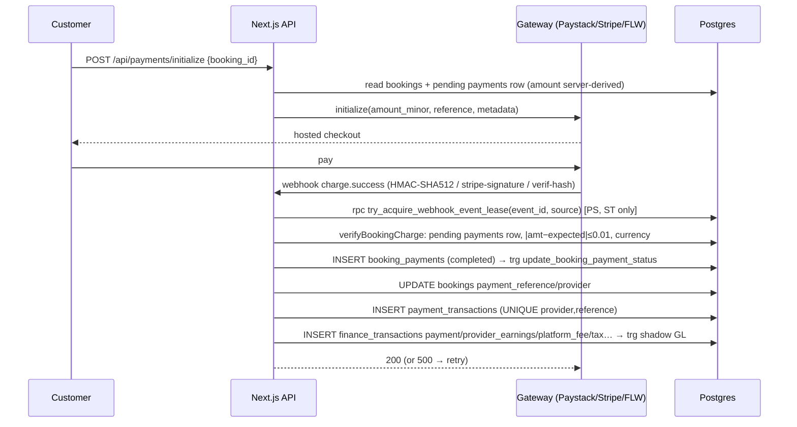
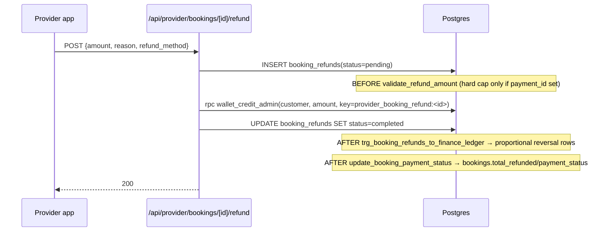

# Phase 2 — Money flow trace & verification

Repo: `Beautonomi` @ HEAD 2026-11-08 · Audit date 2026-11-09 · Read-only.

## 0. Scope, method, legend

| Item | Detail |
|---|---|
| Sources | Source code (`apps/web`, `apps/provider`, `packages/utils`), migrations, **live staging DB catalog** (`beautonomi-staging`, project ref `byfz****`, via PostgREST + `finance_audit_run` read-only RPC using `SUPABASE_SERVICE_ROLE_KEY` from `.env.staging.vercel.local`). No production access. No writes. No gateway calls. |
| Staging data | **0 rows** in `bookings`, `booking_payments`, `payment_transactions`, `finance_transactions`, `journal_*`, `payouts`, `booking_refunds`, all webhook tables; 4 `providers`. ⇒ staging verifies **schema, triggers, RPC bodies, constraints, RLS, grants and arithmetic**, not historical reconciliation. |
| Env note | `apps/web/.env.local` → staging. **`apps/provider/.env.local` and `apps/customer/.env.local` → `beautonomi-production`** (ref `ifyb****`). Not used by this audit; flagged in §10 (F2-17). |
| F-02 (Phase 1) | Resolved: `apps/web/src/lib/supabase/client.ts:19-24` fallback is `https://placeholder.supabase.co` + JWT with `ref="placeholder"` and signature `.placeholder` — **not a real credential**. Downgraded to Low (silent misconfig). |
| Legend | **PASS** verified by code+DB evidence · **FAIL** verified defect · **PARTIAL** · **UNVERIFIED** (reason given) · `[DB]` = verified on live staging catalog · `[SV]` = spot-verified by auditor in source · `[T]` = traced by delegated tracer, citations checked for plausibility only |
| Tracer reports | `p2-A` online payment, `p2-B` payout, `p2-C` refunds, `p2-D` tips/promos/wallet/terminal, `p2-E` subs/VAT/GL, `p2-F` security (kept outside repo in `%TEMP%\beautonomi-audit\`) |

## 1. Live DB facts that frame every flow `[DB]`

### 1.1 Money column types (information_schema, staging)

| Table | Columns | Type |
|---|---|---|
| `bookings` | `subtotal, total_amount, total_paid, total_refunded, tax_amount, tip_amount, travel_fee, deposit_amount, cancellation_fee, platform_fee_amount, service_fee_amount, platform_service_fee, discount_amount, promotion_/membership_/loyalty_discount_amount, gift_card_amount, wallet_amount` | NUMERIC(10,2) |
| `bookings` | `tax_rate, deposit_percentage, platform_fee_percentage, service_fee_percentage, commission_percentage_snapshot, membership_discount_percentage` | NUMERIC(5,2) |
| `booking_payments.amount`, `booking_refunds.amount`, `additional_charges.amount`, `wallet_transactions.amount` | | NUMERIC(10,2), `CHECK (amount > 0)` |
| `payment_transactions` | `amount, fees, net_amount, refund_amount` | NUMERIC(10,2) |
| `finance_transactions` | `amount, commission, fees, net` | NUMERIC(10,2) |
| `payouts` | `amount, net_amount, platform_fee_amount` | NUMERIC(10,2); `CHECK amount>0, net_amount>0, platform_fee_amount>=0` |
| `journal_lines` | `raw_amount, reporting_amount` | NUMERIC(18,4), `CHECK >= 0`, `side IN (debit,credit)` |
| `provider_yoco_payments` | `amount, refund_amount` | **BIGINT (cents)** |
| `provider_yoco_payments` | `tip_amount` | **NUMERIC(12,2) (rands)** — mixed units in one row |

Max representable amount = **99,999,999.99**; larger inserts raise `numeric field overflow` (loud failure, acceptable).

### 1.2 Enums

| Type | Labels |
|---|---|
| `booking_status` | pending, confirmed, in_progress, completed, cancelled, no_show, waiting, checked_in, pending_payment |
| `payment_status` | pending, paid, failed, refunded, partially_refunded, partially_paid |
| `payout_status` | pending, processing, completed, failed (no approved/cancelled/reversed) |
| `paycloud_payment_status` | pending, processing, successful, failed, cancelled, closed |

### 1.3 Uniqueness / idempotency constraints

| Table | Constraint / index | Covers |
|---|---|---|
| `payment_transactions` | UNIQUE(provider, reference) | one gateway ref → one ledger charge row (all rails) |
| `booking_payments` | partial UNIQUE(payment_provider, payment_provider_id) for **paystack, paycloud, yoco, wallet/gift_card only** | **No index for `stripe` or `flutterwave`** → duplicate `booking_payments` rows possible under concurrent webhook delivery (see F2-03) |
| `finance_transactions` | UNIQUE(source_payment_id, transaction_type) WHERE source_payment_id NOT NULL | one leg per type per payment |
| `finance_transactions` | UNIQUE(source_refund_id, refund_component) | refund components idempotent |
| `finance_transactions` | UNIQUE(payout_id) WHERE type='payout'; UNIQUE(payout_id) WHERE type='payout_transfer_fee' | exactly one payout ledger row |
| `finance_transactions` | UNIQUE(description) WHERE type='wallet_topup' | idempotency keyed on free-text description (fragile, F2-18) |
| `payouts` | UNIQUE(provider_id) WHERE status IN (pending, processing) | at most one open payout request per provider |
| `payouts` | UNIQUE(payout_number) | |
| `journal_entries` | UNIQUE(source, external_ref) | one GL entry per source row |
| `webhook_events` | UNIQUE(event_id, source) | lease table for Paystack/Stripe/(Flutterwave read-only) |
| `provider_yoco_payments` | UNIQUE(yoco_payment_id) | |
| `wallet_transactions` | UNIQUE(idempotency_key) WHERE NOT NULL | |
| `paycloud_webhook_events`, `provider_yoco_webhook_events` | **none** (only PK) | no DB-level webhook dedupe for PayCloud/Yoco (F2-04) |

### 1.4 Triggers on money tables (non-internal, all enabled `O`)

| Table | Trigger → function | Timing | Role in money model |
|---|---|---|---|
| `booking_payments` | `create_finance_ledger_on_payment_insert/update` → `create_finance_ledger_from_payment` | AFTER I/U | Posts ledger for **non-online tenders**; returns early for paystack/stripe/flutterwave (TS writes those) |
| `booking_payments` | `update_booking_payment_status_on_payment` → `update_booking_payment_status` | AFTER I/D/U | Recomputes `bookings.total_paid/total_refunded/payment_status` |
| `booking_payments` | `trg_booking_payments_period_lock` → `enforce_finance_period_lock` | BEFORE I/U | Blocks writes into `financial_period_locks` ranges |
| `booking_payments` | `aaa_create_cashback_ledger_*` → `create_cashback_ledger_from_payment` | AFTER I/U | Cashback (paycloud only per tracer A) |
| `booking_refunds` | `validate_refund_amount_trigger` → `validate_refund_amount` | BEFORE I/U | Hard cap only when `payment_id` set; booking-level over-refund >110% is **WARNING only** (F2-22) |
| `booking_refunds` | `trg_booking_refunds_to_finance_ledger` → `create_finance_ledger_from_booking_refund` | AFTER I/U | Proportional component reversal (§5) |
| `booking_refunds` | `update_booking_payment_status_on_refund` | AFTER I/D/U | as above |
| `booking_refunds` | `trg_booking_refunds_period_lock` | BEFORE I/U | |
| `bookings` | `trg_snapshot_booking_commission_percentage` | BEFORE I | Stamps `commission_percentage_snapshot` via `resolve_provider_commission_percentage` |
| `bookings` | `validate_booking_total_trigger`, `validate_tax_calculation_trigger`, `validate_service_fee_calculation_trigger` | BEFORE I/U | Accepts total if it matches **any of 4 formulas** ±0.01 (F2-13) |
| `bookings` | `trg_guard_booking_status_transition` | BEFORE U | **Shadow mode**: logs violations to `booking_status_transition_violations`, never blocks (F2-12) |
| `finance_transactions` | `trg_finance_transactions_shadow_journal` → `shadow_post_finance_transaction` | AFTER I | Double-entry GL; unmapped types → suspense 9999 + reconciliation exception |
| `finance_transactions` | `create_staff_earnings_lines_on_finance_tx`, `create_tip_allocations_on_tip` | AFTER I | Payroll feeds |
| `finance_transactions` | `trg_finance_transactions_period_lock`, `finance_transactions_default_currency` | BEFORE I/U | |
| `journal_lines` | `trg_journal_lines_balance` → `enforce_journal_entry_balance_row` | AFTER I/D/U | Raises if Σdebit ≠ Σcredit per entry (hard) |
| `payouts` | `on_payout_status_update_total_paid_out` | AFTER I/U | `providers.total_paid_out` = Σ completed `net_amount` |
| `payouts` | `on_payout_created_set_number` | BEFORE I | |

### 1.5 Commission configuration (staging values — config, not PII)

| Setting (`platform_settings.settings.payouts`) | Global row | Tenant rows |
|---|---|---|
| `commission_enabled` | **false** | false, false |
| `platform_commission_percentage` | 0 | 0, 0 |
| `platform_service_fee_type` / `_fixed` / `_percentage` | fixed / 15 / 5 | fixed/15/5 · percentage/16/10 |
| `new_account_cooling_off_hours` | 48 | 48 |
| `cooling_off_first_account` / `cooling_off_admin_added` | false / true | |
| `feature_flags.finance.provider_vat_payout` | false | |

⇒ On staging the platform earns only the **service fee**; commission is 0. **Production values UNVERIFIED** (no prod access). All commission arithmetic below assumes 15% for illustration.

### 1.6 RLS and grants on money tables `[DB]`

| Table | RLS | Write policies reachable by end users |
|---|---|---|
| `booking_refunds` | on | **`Providers can manage refunds` — `FOR ALL`, permissive, no `WITH CHECK`**, granted to any provider owner **or any `provider_staff` member** of the booking's provider. `authenticated` has table INSERT/UPDATE/DELETE grants. ⇒ a staff member can insert/update/delete refund rows via PostgREST with their own JWT, bypassing `requirePermission("process_payments")` (F2-01) |
| `additional_charges` | on | `Customers can update own booking additional charges` — `FOR UPDATE`, no `WITH CHECK`, no column restriction ⇒ customer can set `amount`/`status='paid'`/`paid_at` on their own booking's charge (F2-02) |
| `finance_transactions`, `payouts`, `booking_payments`, `payment_transactions`, `wallet_transactions`, `provider_payout_accounts`, `journal_*` | on | writes only via `service_role` / superadmin policies — PASS |
| SECURITY DEFINER RPCs executable by `authenticated` | | `reserve_gift_card_redemption`, `capture_*`, `void_*`, `wallet_debit_self`, `lookup_gift_card_by_code` (§7); also callable by **`anon`**: `reserve_gift_card_redemption`, `*_for_sale` variants, `_shadow_replay_membership_gift_card_row`, `log_finance_ledger_trigger_failure` (function bodies require `auth.uid()` for reserve; `_shadow_replay_*` and `log_*` are internal and should not be anon-executable — F2-11) |

## 2. Arithmetic verification (executed) `[DB]`

### 2.1 Rounding semantics — JS vs Postgres (executed via Node and staging `SELECT`)

| Input | `Math.round(x*100)/100` (plain, ≥12 sites) | `roundMoney2` (+EPSILON) | PG `ROUND(numeric,2)` |
|---|---|---|---|
| 1.005 | 1.00 | 1.01 | 1.01 |
| 0.285 | 0.28 | 0.29 | 0.29 |
| 1.255 | 1.25 | 1.26 | 1.26 |
| 8.325 | 8.32 | **8.32** | **8.33** |
| 4.345 | 4.35 | 4.35 | 4.35 |
| −1.005 | −1.00 | −1.00 | **−1.01** |
| 49.9995 (=333.33×0.15) | 50.00 | 50.00 | 50.00 |

`percentOf` (`packages/utils/src/money.ts:107-112`, integer-cents based) matched PG `ROUND(base*rate,2)` on **all 33,333** tested bases (0 mismatches). Plain float `Math.round(x*100)/100` does **not** match PG for half-cent inputs.

### 2.2 Commission base: TS vs DB trigger (33,333 partial-payment amounts, T=333.33, pf=15.00, tax=41.52)

| Path | Formula | Source |
|---|---|---|
| TS (online rails) | `Math.round(P × ((T−pf−tax−travel−tip)/T) × 100)/100` — full-precision float ratio | `apps/web/src/lib/bookings/resolve-commission-base-for-booking-payment.ts:42-46` [SV] |
| DB trigger (cash/wallet/gift/terminal) | `ROUND(P × ratio::NUMERIC(10,6), 2)` — ratio truncated to 6 dp | `create_finance_ledger_from_payment` lines 871-874, 908 [DB] |

Result (exact JS semantics emulated with `floor(x+0.5)` on float8): **169 / 33,333 (0.5%) amounts give a 1-cent different `commission_base`; 25 give a different commission** (e.g. P=13.24 → TS 11.00 vs DB 10.99; P=25.33 → TS 21.04 / 3.16 vs DB 21.03 / 3.15). Max delta 0.01. → F2-05.

### 2.3 Worked example A — R333.33 booking, VAT-inclusive 15%, fixed platform fee R15, 15% commission, platform-held, full payment then refunds (executed in PG with the trigger's exact formulas)

Inputs: services `S = 318.33` (VAT-incl) + `platform_fee 15.00` ⇒ `total_amount 333.33`; `tax_amount = round(318.33 − 318.33/1.15, 2) = 41.52`; `net_ratio = (333.33−15−41.52)/333.33 = 0.830432`.

| Stage | `v_total` | `v_ratio` | provider_earnings (net) | platform_fee (net) | tax (amount; net 0) | payment.commission | Cash total |
|---|---|---|---|---|---|---|---|
| Post payment | | | 235.29 | 15.00 | 41.52 | 41.52 | **333.33** ✓ |
| Refund 0.01 (fresh booking) | 333.33 | 0.00003000 | −0.01 | 0.00 | 0.00 | 0.00 | −0.01 ✓ (penny lands on provider_earnings) |
| Single full refund 333.33 | 333.33 | 1.00000000 | −235.29 | −15.00 | −41.52 | −41.52 | −333.33 ✓ exact |
| 1st partial refund 100.00 | 333.33 | 0.30000300 | −70.58 | −4.50 | −12.46 | −12.46 | −100.00 ✓ |
| 2nd refund 233.33 (remainder) | **433.33** | **0.53845799** | **−180.53** | −8.08 | −22.36 | −22.36 | −233.33 ✓ (cash) |
| **Σ after 100 + 233.33** | | | **251.11 vs 235.29 recognised (+15.82 over-clawed from provider)** | 12.58 vs 15.00 (−2.42) | 34.82 vs 41.52 (−6.70) | 34.82 vs 41.52 (−6.70) | 333.33 ✓ |

Commission base 276.81; commission `round(276.81×0.15,2) = 41.52`; earnings 235.29. A **single** refund of any amount reconciles to the cent. A **sequence** of partial refunds does **not**: `v_total := GREATEST(total_amount + cancellation_fee, total_paid + total_refunded, 0.01)` [DB line 401] grows by the prior refund because `bookings.total_paid` is never reduced by refunds (`update_booking_payment_status` sums completed/partially_refunded payments), and the component sums exclude only refund rows (`source_refund_id IS NULL`), not prior reversals. The residual `v_adj` then dumps the shortfall on `provider_earnings` [DB lines 555-561]. Cash still balances, allocation does not: the provider is over-charged R15.82 and the platform keeps R9.12 commission+fee plus R6.70 VAT on a fully refunded booking. → **F2-06** (High). Independently derived by tracer C (§10.2) with different inputs; confirmed here by executing the trigger's formulas on staging.

### 2.4 Worked example B — three-way splits

| Case | Result |
|---|---|
| 333.33 / 3 (naive per-share round) | 111.11 ×3 = 333.33 ✓ |
| 100.00 tip across 3 staff via `create_tip_allocations_on_tip_transaction` (`ROUND(tip×share/total,2)`, **no residual fix**) | 33.33 ×3 = **99.99 (−0.01)** |
| 10.00 / 3 | 9.99 (−0.01) |
| 0.05 / 2 | 0.03 ×2 = **0.06 (+0.01 over-allocated)** |
| 1.00 / 6 | 0.17 ×6 = 1.02 (+0.02) |
| `splitMoneyProportionally` (`packages/utils/src/money.ts:174-201`) | floor + distribute remainder → always sums exactly (not used by the trigger) |

→ F2-07 (tip allocations don't sum to the tip).

### 2.5 Worked example C — payout then refund (tracer B, formulas [SV])

3 completed Paystack bookings, earnings 235.29 each (from §2.3) ⇒ `onlineEarnings 705.87`; payout 705.87 completed ⇒ balance 0.00; refund R100 on one booking posts `refund/provider_earnings −70.58` ⇒ `rawBalance −70.58`, `availableBalance 0`, `hasNegativeBalance true`, `GET /api/provider/finance.balance_owed_to_platform = 70.58`; next `POST /api/provider/payouts` → 409 `NEGATIVE_BALANCE`; recovery only via future earnings (`docs/FINANCE_PRODUCT_DECISIONS.md` L14). No clawback job exists.

### 2.6 Max amount

NUMERIC(10,2) ceiling 99,999,999.99. Paystack minor units for that = 9,999,999,999 (< 2^53). `insert_payout_request_guarded` has no upper bound beyond ≤ available. Gateway-side maxima UNVERIFIED.

## 3. Flow — Customer online payment → commission → provider earnings `[T:A]` `[SV]` `[DB]`

### 3.1 Path

`Customer app/web` → `POST /api/payments/initialize` (`apps/web/src/app/api/payments/initialize/route.ts`) or booking-create `process-payment.ts` → `initializeOnlinePayment` (`apps/web/src/lib/payments/online-payment.ts:73-140`) → gateway hosted page → **webhook** `POST /api/payments/webhook` (Paystack) / `payments/stripe/webhook` / `payments/flutterwave/webhook` → `processSuccessfulPayment` (`apps/web/src/app/api/payments/webhook/_handlers/charge-success.ts`) → `recordGatewayBookingPayment` → `booking_payments` → trigger `update_booking_payment_status` → `bookings.total_paid/payment_status` → `recordBookingOnlineChargeLedger` (`apps/web/src/lib/bookings/record-booking-online-charge-ledger.ts`) → `payment_transactions` + `finance_transactions` (payment, provider_earnings, platform_fee, tax, tip, travel_fee) → trigger `shadow_post_finance_transaction` → `journal_entries/lines`.



### 3.2 Amount & commission formulas (as code)

| Step | Formula | Cite |
|---|---|---|
| Total | `totalAmount = taxIncluded ? sumMoney(baseAfterLoyalty, tip, serviceFee) : sumMoney(baseAfterLoyalty, tip, tax, serviceFee)` | `apps/web/src/app/api/public/bookings/_helpers/validate-booking.ts:1621-1623` |
| VAT | `computeVat` inclusive: `tax = roundCurrency(gross − gross/(1+r))` | `packages/utils/src/vat/computeVat.ts:20-41` |
| Platform (service) fee | `percentOf(base, pct)` capped by `max_fee_amount`, or fixed `fee_fixed_amount`; `show_service_fee_to_customer=false ⇒ 0` | `validate-booking.ts:1554-1605` |
| Deposit | `percentOf(totalAmount, provider.deposit_percentage ?? 30)` | `process-payment.ts:153-154` |
| Commission rate | `bookings.commission_percentage_snapshot` → `platform_settings.payouts.{commission_enabled, platform_commission_percentage}` → `providers.commission_override` | TS `apps/web/src/lib/finance/resolve-commission-percentage.ts:7-47`; SQL `resolve_provider_commission_percentage` [DB] |
| Commission base (1st charge) | `round2(P × (T − tip − tax − travel − platformFee)/T)` | `resolve-commission-base-for-booking-payment.ts:42-46` |
| Commission base (later charges) | `min(P, round2(cumulativePaid − postedLegsSum))` | ibid :31-34 |
| Commission | `percentOf(commissionBase, rate)`; `providerEarnings = subtractMoney(base, commission)`; gateway `fees` borne by platform (`payment.fees`), never deducted from earnings | `record-booking-online-charge-ledger.ts:286-292, 376-396` |
| Tender class | `PLATFORM_HELD = {paystack, stripe, flutterwave, wallet, gift_card}` (TS) vs trigger literal `('wallet','gift_card','stripe','flutterwave')` + early return for paystack/stripe/flutterwave vs RPC literal (3 declarations) | `available-payout-balance.ts:89-95`; trigger line 854 [DB]; `10105_…sql:113` |

### 3.3 Checklist

| Check | Result | Evidence |
|---|---|---|
| Amount source server-side | **PASS** | `initialize/route.ts:57,146,175` ignores client amount; webhook `verifyBookingCharge` `|paid−expected|>0.01 ⇒ amount_mismatch` (`verify-paystack-booking-charge.ts:87-115`) |
| Signature verified, timing-safe | **PASS** PS (`webhook/route.ts:151-155` HMAC-SHA512 + `timingSafeEqual`), FW (`flutterwave-server.ts:68-77`); **UNVERIFIED** Stripe SDK internals; **FAIL-dev** FW accepts unsigned when `NODE_ENV!=='production'` and `VERCEL_ENV` unset (`flutterwave-webhook-verify.ts:97-107`) |
| Idempotent on duplicate webhook | **PASS** PS/ST (lease RPC verified [DB] §1.4; `webhook_events` UNIQUE) · **FAIL** FW: select-then-insert, insert error ignored, `eventId = data.id ?? tx_ref ?? randomUUID()` (`flutterwave/webhook/route.ts:51-73`) |
| Duplicate `booking_payments` row under concurrency | **PASS** PS/yoco/paycloud/wallet/gift (partial unique indexes [DB]) · **FAIL** Stripe/Flutterwave — no index; `record-booking-stripe-payment.ts:40-45` select-then-insert ⇒ `total_paid` can double (F2-03) |
| Out-of-order safe | **PARTIAL** — `charge.failed` after success skipped (`charge-success.ts:2023-2056`, provider hard-coded `'paystack'` :2026); **`charge.success` after cancellation NOT guarded** in webhook path ([SV] `charge-success.ts:884-1088` has no `status==='cancelled'` check; only `/api/paystack/verify:739-745` returns 409) ⇒ cancelled booking can become `paid` with ledger rows and no auto-refund (F2-08) |
| Atomic ledger write | **FAIL** — ≥6 sequential PostgREST calls, no transaction; recovery by gateway retry + backfill (`record-booking-online-charge-ledger.ts:213-225,341-348`); partial-state windows documented in tracer A §4 |
| Commission formula consistent across rails | **PASS** (all 3 online rails → same TS writer) · **FAIL cross-tender**: TS float ratio vs trigger `NUMERIC(10,6)` ratio differ on 0.5% of partial amounts (§2.2, F2-05) |
| Rounding single-sourced | **FAIL** — ≥12 local `Math.round(x*100)/100` sites (tracer A §2.3); `calculateBookingPricing.ts:87-95` (client/provider UI) unrounded; `booking-pricing.ts:41` inclusive tax unrounded vs `computeVat` rounded |
| Platform-held set single-sourced | **FAIL** — 3 declarations (§3.2) |
| Verify mismatch handling | **PARTIAL** — mismatch/no-pending ⇒ `payment_reconciliation_exceptions` + Slack, **200 ack, money not refunded** (`charge-success.ts:941-957`); product orders auto-refund, bookings don't |
| Stripe `payment_intent.payment_failed` | **FAIL** — Slack only, no DB state (`stripe/webhook/route.ts:293-319`) |
| Ledger trigger failure mode | **FAIL-open** — `create_finance_ledger_from_payment` `EXCEPTION WHEN OTHERS → log + RETURN NEW` [DB lines 1029-1033] ⇒ payment commits with no ledger rows; detected only by `list_booking_payments_missing_provider_earnings` RPC / drift job |
| Audit trail | **PARTIAL** — `webhook_events` payload persisted; `finance_transactions` has `created_at`, no `created_by` for system rows; booking status changes logged by `booking_status_change_audit` [DB] |
| What provider sees | `bookings.total_paid/payment_status` (trigger-derived) via `GET /api/provider/bookings/[id]`; earnings = Σ `finance_transactions.provider_earnings.net` via `GET /api/provider/finance` (`finance/route.ts:373,609`); available balance from `getAvailablePayoutBalance` — same function as payout POST (**PASS** consistency) |

## 4. Flow — Provider balance → payout request → approval → transfer → ledger `[T:B]` `[SV]` `[DB]`

### 4.1 Path

`apps/provider .../more/payouts.tsx` → `GET /api/provider/finance` (balance) → `POST /api/provider/payouts` (`apps/web/src/app/api/provider/payouts/route.ts:100-436`) → `getAvailablePayoutBalance` → RPC `insert_payout_request_guarded` [DB] → `payouts(pending)` → admin `POST /api/admin/payouts/[id]/approve` (`processing`) → `initiate-transfer` (Paystack `createTransfer` ref `payout_<id>` / Stripe `transfers.create` idempotencyKey / FLW) → webhook `transfer.success` (`_handlers/transfer-events.ts`) → `recordPayoutLedger` (`finance_transactions type='payout'`, UNIQUE payout_id [DB]) → `payouts.completed` → trigger `update_provider_total_paid_out`.

```mermaid
sequenceDiagram
  participant P as Provider app
  participant API as Next.js API
  participant DB as Postgres
  participant A as Admin
  participant GW as Paystack
  P->>API: GET /api/provider/finance
  API->>DB: finance_transactions (earnings,tip,travel,cancel_fee,refund,payout,tax) + bookings + booking_payments + payouts + payment_disputes
  API-->>P: available_balance, pending_payouts, on_hold, owed_to_platform
  P->>API: POST /api/provider/payouts {amount, bank_account_id}
  API->>API: edit_settings perm, rate limit, KYC, fraud hold, amount≥min(100), cooling-off, currency
  API->>DB: getAvailablePayoutBalance (TS snapshot)
  API->>DB: rpc insert_payout_request_guarded(provider, max_before_reserve, payout)
  Note over DB: pg_advisory_xact_lock(provider); recheck holds, pending Σ, disputes; INSERT payouts(pending)
  A->>API: POST /admin/payouts/[id]/approve → processing
  A->>API: POST /admin/payouts/[id]/initiate-transfer
  API->>GW: POST /transfer {amount_minor, recipient, reference: payout_<id>}
  GW->>API: webhook transfer.success
  API->>DB: INSERT finance_transactions(payout) [UNIQUE payout_id] then UPDATE payouts completed
```

### 4.2 Balance formula (as code, `apps/web/src/lib/provider/available-payout-balance.ts`)

```
rows = finance_transactions WHERE provider_id AND transaction_type IN (provider_earnings, membership_provider_earnings, payout, refund, cancellation_fee, tip, travel_fee, service_fee, tax)   (L183-193; no status filter)
exclude row if its booking_payments tender ∉ PLATFORM_HELD (per source_payment_id, else per booking; fail-open when booking has no completed payment)   (L310-373)
hold row if booking.status ≠ completed, or completed_at > now − holdDays   (L283-300); refunds never held
rawAvailable = onlineEarnings + vatHeldForProvider − completedPayouts(not reversed) − pendingPayoutsSum(not ledger-covered) − openDisputeReserve   (L542-543)
available = max(0, roundMoney2(rawAvailable)); hasNegative = raw < −0.01   (L544-546)
```

### 4.3 Checklist

| Check | Result | Evidence |
|---|---|---|
| Balance deterministic & cited | **PASS** | §4.2; tests `available-payout-balance*.test.ts` (3 files) |
| Hold period | **PASS (config, default 0 = off)** | `payouts/route.ts:187` `payout_hold_days ?? 0` |
| Min payout server-side | **PASS (TS only)** | `payouts/route.ts:185-193` default 100; RPC has no minimum [DB] |
| Concurrency | **PARTIAL** | RPC advisory lock + in-lock recheck of pending Σ and dispute reserve [DB lines 1401-1436]; **earnings side is a TS snapshot** passed as `p_max_available_before_reserve` ⇒ small TOCTOU window; one-open-request unique index [DB] limits blast radius |
| Amount validation | **PASS w/ caveat** | `>0` route + RPC + CHECK [DB]; `≤ available` route + RPC; >2dp **rounded not rejected** (`route.ts:175`); non-numeric string ⇒ RPC `INVALID_AMOUNT` unmapped ⇒ 500 (F2-19) |
| Payout-account cooling-off | **PASS** | 48h default; first account exempt by default (`resolve-new-account-cooling-off.ts:6-15`); enforced at request (`route.ts:318-325`) and admin (`validate-provider-payout-readiness.ts:61-98`) |
| Payout-account change audited | **FAIL** | no `writeAuditLog` in `api/provider/payout-accounts/**`; only `metadata.added_by` + owner notification (F2-09) |
| Step-up auth on bank change | **FAIL (default off)** | `provider-security.ts:25-32,345-346` policy default `off` (F2-10) |
| Admin transitions permission-checked | **PASS** | every admin payout route `requireAdminSection(ADMIN_SECTION_FINANCE)` + tenant check |
| Dual control | **FAIL** | same finance-admin role can approve and initiate transfer; no second approver (F2-20) |
| Admin re-checks amount ≤ available | **FAIL** | only `hasNegativeBalance` checked at approve/transfer (`validate-provider-payout-readiness.ts:146-164`) |
| Transfer idempotent | **PASS** Stripe (`idempotencyKey`) · **UNVERIFIED** Paystack/FLW gateway-side (deterministic `reference`, app-side claim) |
| `transfer.failed/reversed` returns funds | **PASS** Paystack (`reverseCompletedPayoutLedger`, `metadata.reversed_at`, never DELETE) / Stripe · **FAIL** Flutterwave (`flutterwave-transfer-webhook.ts:113-116` sets failed, no ledger reversal; later event may be dropped as duplicate of `data.id`) (F2-21) |
| Ledger row exactly once | **PASS** | partial UNIQUE [DB] + idempotent skip (`record-payout-ledger.ts:97-120`); ledger-before-status everywhere |
| Transfer amount mismatch | **PARTIAL** | Paystack `|transfer−net_amount|>0.01` ⇒ warn + Slack only, still completes (`transfer-events.ts:169-192`) |
| Refund after payout | **PASS as designed** | negative raw balance blocks new payouts; no clawback (product decision) — §2.5 |
| App shows same balance as server | **PASS** | same `getAvailablePayoutBalance(holdDays, tenantId)` in `finance/route.ts:187-190` and `payouts/route.ts:203-210` |
| State machine | enum pending→processing→completed/failed; `failed` terminal (new request needed); `completed→failed` only via verified GL reversal (PS/ST) | tracer B §4.2 |

## 5. Flow — Refunds, cancellations, disputes, failed/retried payments `[T:C]` `[SV]` `[DB]`

### 5.1 Entry points

| # | Entry | Guard | Amount validation | Ordering |
|---|---|---|---|---|
| A | `POST /api/provider/bookings/[id]/refund` | `requirePermission('issue_refunds')` :48-52; provider/tenant/branch scoping :145-167 | client `amount` :77-81; `>0`; ≤ `max(total_paid, wallet+gift) − total_refunded` :200-214; per-rail caps (wallet/cash/terminal) :241-292; **no 2dp normalisation** | DB-first: insert `booking_refunds(pending)` → `wallet_credit_admin` (key `provider_booking_refund:<id>`) → flip `completed`; wallet error ⇒ row `failed`; finalize error after credit ⇒ 500 with wallet credited and no ledger (:679-686) |
| B | `POST /api/admin/bookings/[id]/refund` | `requireAdminSection(PROVIDERS_OPERATIONS)` | rejects `partially_refunded` status (:69-71) — remainder refunds must use route C | → `issueAdminWalletRefund` |
| C | `POST /api/admin/refunds/[id]` (per payment_transaction) | `requireAdminSection(FINANCE)` | `≤ effectiveRemaining + 0.001` | → `issueAdminWalletRefund` (CAS claim on `payment_transactions.refund_amount`, period lock, rollback on wallet error; finalize failure log-only :379-385) |
| E | `POST /api/provider/paycloud/payments/[id]/refund` | `requirePermission('process_payments')` (**not** `issue_refunds`) | ≤ amount+tip+cashback−refunded+0.02 | Gateway-first; `booking_refunds` written by webhook |
| F/H | Paystack `refund.processed`, Stripe `refund.created` | signed webhook | **none vs remaining**; gateway amount inserted as `completed` | idempotent on `refund_provider_id` lookup (check-then-insert; **no unique index** [DB §1.3]) |
| J | Flutterwave refund webhook | — | — | **not implemented** (`flutterwave/webhook/route.ts:76-84` routes only transfer/dispute/charge) |
| Direct PostgREST | any provider owner **or staff** JWT | `validate_refund_amount` only (payment-level hard cap; booking-level WARNING) | RLS `FOR ALL` policy [DB §1.6] — bypasses A entirely (F2-01) |



### 5.2 Refund trigger semantics (live body, §2.3)

`ratio = LEAST(1, amount / GREATEST(total_amount + cancellation_fee, total_paid + total_refunded, 0.01))`; components from original rows (`source_refund_id IS NULL`): provider_earnings, tip, travel_fee, platform_fee|service_fee, tax(amount), payment(amount, commission), cancellation_fee, walk_in_additional_charge, additional_charge_payment, plus non-cash parallels (discounts, wallet/gift legs); each `−ROUND(x×ratio, 2)`; residual to provider_earnings; `completed→failed` deletes reversals; `completed→cancelled` leaves them (gap); DELETE of a refund row leaves orphan reversals (no trigger on DELETE for the ledger; `update_booking_payment_status` does fire on DELETE so `total_refunded` is recomputed — ledger and booking then disagree).

### 5.3 Checklist

| Check | Result | Evidence |
|---|---|---|
| Refund ≤ remaining enforced | **PARTIAL** | Routes A/B/C/chargeback cap it; webhooks F/H do not; DB hard-caps only per `payment_id` (`validate_refund_amount` [DB]); booking-level over-refund >110% is `RAISE WARNING` only; excess lands on `provider_earnings` via `v_adj` (F2-22) |
| Amount server-recomputed | **FAIL (by design)** | client-supplied amount, server caps only; no 2dp normalisation (DB rounds; wallet RPC receives raw) |
| Single refund reconciles | **PASS** | §2.3 executed |
| Sequential partial refunds reconcile | **FAIL** | §2.3: 100 + 233.33 over-claws provider R15.82, under-reverses commission/fee/VAT (F2-06, High) |
| Residual cent | **PASS** | `v_adj` → provider_earnings |
| Retry idempotent | **PASS** | `EXISTS source_refund_id` guard + UNIQUE(source_refund_id, refund_component) [DB] |
| `total_refunded`/`payment_status` consistent | **PASS** | `update_booking_payment_status` recomputes on I/U/D [DB] |
| Provider-collected refunds ledgered | **PASS** | commission 0 ⇒ full clawback on provider_earnings; excluded from payout by tender |
| Refund row write surface | **FAIL** | provider owner/staff can INSERT/UPDATE/DELETE `booking_refunds` directly (RLS) (F2-01) |
| Cancellation fee formula | **PASS (cited)** | `resolve-cancellation-outcome.ts:95-99,229-273`; `settle-booking-cancellation.ts:203-244,600-602`; fee retained 100% by provider as `cancellation_fee` row (commission 0) `:278-293`; idempotency by `(booking_id, type)` existence check, **not a constraint** |
| Cancellation fee vs residual earnings | **UNVERIFIED** | provider keeps `(1−ratio)·pe` **and** `cancellation_fee=F`; whether this double-counts depends on commission; no test asserts provider-side total |
| Cancellation ordering | **PARTIAL** | status → `cancelled` first, money after; crash leaves `cancellation_settlement_error` for a cron whose route was not located |
| Dispute reserve | **PASS** PS/Stripe-open · **FAIL** FLW & Stripe closed/funds_withdrawn | reserve keyed on `payment_disputes.provider_id` (`available-payout-balance.ts:525-540`); FLW handler never sets it; Stripe closed/funds_withdrawn upsert `provider_id: null` may null it (UNVERIFIED upsert semantics) |
| Dispute amount | **FAIL** | PS/FLW heuristic `n ≥ 1000 ⇒ minor units else major` (`paystack-dispute-lifecycle.ts:49-65`; FLW `:11`) misreads e.g. 500 kobo as R500 (then capped to remaining) (F2-15) |
| Dispute idempotent | **PARTIAL** | `payment_disputes` upsert keyed; chargeback refund check-then-insert, no unique on `refund_provider_id` |
| Provider notified of dispute | **FAIL** | no provider notification in any dispute/chargeback module (grep 0) |
| `charge.failed` | **PASS** | success-then-failed guard; atomic claim `WHERE payment_status='pending'`; tested |
| failed-then-success (bookings) | **FAIL** | `alreadySettledPaymentTx` lookup is status-agnostic (`charge-success.ts:912-917` [SV]); later `charge.success` after a `failed` row ⇒ `booking_payments` completed + `payment_status=paid`, booking stays `cancelled`, `payment_transactions` stays `failed`, no gateway refund (product orders do refund) (F2-16, High); no test |
| Dunning | **PASS (PS/FLW)** | `cron/retry-subscription-payments` days 1/3/5; Apple/Stripe excluded; 3-day grace re-anchored on each retry (`updated_at`) |
| Flutterwave refund reconciliation | **FAIL** | no inbound refund handler |
| Provider sees | earnings drop by `provider_earnings`(+tip/travel/cancel/walk_in) components only (`finance/route.ts:478-504`, `refund-components.ts:25-53`); balance via `getAvailablePayoutBalance` | PASS consistent with contract |

## 6. Flow — Tips, discounts, gift cards, wallet, additional charges, terminals `[T:D]` `[DB]` `[SV]`

### 6.1 Formulas

| Item | Formula / rule | Cite |
|---|---|---|
| Tip | excluded from commission base (`T − tip − tax − travel − pf`); own `tip` row `commission 0`; included in payout unless provider-collected or on hold | `resolve-commission-base…:42-46`; `available-payout-balance.ts:440-459` |
| Per-payment tip | `apply_booking_payment_tip(payment_id, tip)`: `round(GREATEST(tip,0),2)`, idempotent via `booking_tip_applications` PK, bumps `bookings.tip_amount/total_amount` [DB] | live body lines 1-43 |
| Tip → staff | `ROUND(total_tips × staff_price/total_price, 2)` per staff, **no residual fix**, skips if any allocation exists (second tips never allocated) | `create_tip_allocations_on_tip_transaction` [DB]; §2.4 |
| Discount order | package → promo (`percentOf(prePromoSubtotal)` capped) → membership → loyalty (`round2(points/rate)`) → VAT on `baseAfterLoyalty` → platform fee → tip → total | `validate-booking.ts:1347-1622` |
| Who absorbs discounts | commission base uses post-discount `total_amount` ⇒ **provider absorbs** all discounts incl. platform promos (`provider_id IS NULL`); no platform-funded mechanism | `record-booking-online-charge-ledger.ts:232-275` |
| Provider-created booking | promo/package re-resolved server-side; **client `membership_discount_amount` overrides server value** (`provider/bookings/route.ts:1556-1558`) — provider-trusted, provider absorbs | |
| Gift card reserve | atomic `UPDATE … SET balance = balance − p_amount WHERE balance >= p_amount` [DB]; requires `auth.uid()`; **no booking-ownership check** ⇒ any authenticated user can reserve any card (code known) against any booking id (balance lock-up; code oracle "Invalid gift card code" vs "Insufficient"); EXECUTE granted to `anon` and `authenticated` [DB] (F2-23) | live body lines 1842-1906 |
| Wallet | `user_wallets.balance CHECK (>= 0)`; debit RPCs `FOR UPDATE` + raise; `wallet_debit_self` has **no idempotency key**; `wallet_credit_self` revoked (dead) | `002:69-87`, `376:206-259`, `929` |
| Wallet/gift at checkout | `wallet`, `gift_card` are platform-held ⇒ commission applies and earnings payoutable; trigger skips wallet/gift synthetic rows when a `payment` row already exists for the booking [DB lines 781-789] | |
| Additional charge create | `z.object({description: min(1), amount: positive()})` — **no max, no scale** (F2-25) | `request-payment/route.ts:15-18` [SV Phase 1] |
| Additional charge tenders | online/card-on-file/terminal → `settleAdditionalChargePlatformHeld` (full commission on gross); cash/manual/yoco → RPC `record_walk_in_additional_charge_payment` (`FOR UPDATE` booking+charge, `ON CONFLICT (provider, reference)`, commission 0) [DB] | |
| Customer can edit `additional_charges` | RLS UPDATE policy without column restriction (F2-02) | [DB §1.6] |
| Terminal units | Yoco: `amount` BIGINT cents + `tip_amount` NUMERIC rands in the same row; refunds `amountCents/100` hard-coded (`yoco/webhook/route.ts:584,619`); device totals add cents into NUMERIC (`:398-408`); provider app `Math.round(amount*100)` (`CardMachineCollectSheet.tsx:190`) not `toMinorUnits` | |
| Terminal webhooks | Yoco: Standard-Webhooks HMAC-SHA256 ±180s + legacy fallback, timing-safe; PayCloud: RSA2, settle gated on `signatureValid`, **returns 200 regardless**, DB lookups before verification (probe oracle) | `yoco-webhook-verify.ts`, `paycloud/webhook/route.ts:21-102` |
| Terminal dedupe | event tables have **no UNIQUE** [DB]; money rows protected by partial unique indexes on `booking_payments` / `provider_yoco_payments` [DB] | |
| Terminal IDOR | PayCloud + Paystack Terminal provider-scoped; **Yoco bare `entity_type/entity_id` skips creation guards** (`yoco/payments/route.ts:427-435`), settle later scoped by provider | |
| Paystack Terminal base booking | `commissionMode: "provider_collected"` (0 commission) **but** `payment_provider = paystack` ⇒ payout-eligible; add-ons via same route take full commission — intent UNVERIFIED | `terminal-payments/[id]/allocation/route.ts:182` |

### 6.2 Checklist

| Check | Result |
|---|---|
| Tips excluded from commission | **PASS** |
| Tips in payout balance | **PASS** (platform-held only) |
| Tip allocations sum to tip | **FAIL** (§2.4; F2-07) |
| Discount order single-sourced | **FAIL** (public vs provider-create sequences; client membership override) |
| Commission base pre/post discount consistent | **PASS** (post-discount, both paths) |
| Gift reserve/capture atomic + idempotent | **PASS w/ caveat** (no ownership check — F2-23) |
| Wallet never negative | **PASS** (DB CHECK) |
| Additional charge amount bounded | **FAIL** (F2-25) |
| Terminal signatures verified | **PASS** (PayCloud returns 200 on bad signature — reconsidered Low: settle gated) |
| Terminal webhook UNIQUE dedupe | **FAIL** (event tables); money rows protected |
| Cents↔rands single-sourced | **FAIL** |
| Terminal allocation IDOR-safe | **PASS w/ gap** (Yoco bare entity) |
| Migration precedence | **FAIL** — `1027_provider_portal_till_no_platform_fee.sql` (`v_pf := 0` for provider/walk_in source) and `10104_…` both redefine `create_finance_ledger_from_payment`; **live staging body = 10104 (no 1027 guard)** [DB] ⇒ 1027's fix is not deployed (F2-14) |

## 7. Flow — Subscriptions, VAT, FX, shadow GL, adjustments, invoices, payroll, period locks `[T:E]` `[DB]` `[SV]`

| Area | Verified behaviour | Result |
|---|---|---|
| Provider subscription money | single writer `recordProviderSubscriptionPayment` (`provider-subscription-payment.ts:283-582`): idempotent on `payment_transactions(provider, reference)`; `provider_subscription_payment` row `net=0` (deferred, GL 2810) + VAT `tax` leg; daily `subscription_recognition`; reversal splits deferred/recognised | PASS |
| Apple IAP | StoreKit-2 JWS verified server-side, chain pinned to Apple Root CA-G3 (`jws.ts:84-157`); `apple_iap_transactions.transaction_id UNIQUE`; ASN v2 webhook leased by `notificationUUID`; **`APPLE_IAP_VERIFY_JWS=false` disables verification** (env name only) | PASS w/ kill-switch caveat |
| Subscription webhooks | `subscription.*`/`invoice.*` **not in `RETRYABLE_EVENTS`** (`webhook/route.ts:468`) ⇒ handler errors ack 200, no gateway retry | PARTIAL |
| Dunning | days 1/3/5 (PS/FLW); grace 3d re-anchored per retry | PASS |
| Entitlement RPCs | `get_provider_subscription_tier` (286) and `get_provider_subscription_plan` (10101) both live with different grace semantics; TS mirrors SQL | PARTIAL |
| VAT formula | canonical `computeVat` rounds tax first; `receipts/vat-inclusive-breakdown.ts:26-27` rounds net first ⇒ 1c divergence possible; subscription receipts recompute VAT at render with **current** platform rate | FAIL (single-sourcing) |
| `provider_vat_number_snapshot` | written only by `create-group-participant-booking.ts:143`; never for standard bookings/orders | FAIL |
| VAT on commission | commission posted gross to 3000; no VAT leg on platform commission/platform fee; no platform-registration flag; policy undocumented | UNVERIFIED (policy) |
| **Provider VAT report** | `vat-reports/route.ts:122` select omits `transaction_type`; `:184-187,196-199` branch on it ⇒ **every row dropped, `vat_collected` always 0**; test passes because mocks include the column (`vat-reports-refunds.test.ts:102,113`). Mobile `vat-reports.tsx` consumes it | **FAIL [SV]** (F2-24, High) |
| FX | Frankfurter cron → `fx_reference_rates`; `convert_to_reporting_amount` 4dp; shadow GL posts `reporting_amount = raw_amount`, `fx_rate=1` (no conversion at posting); `revert_journal_for_finance_tx` hard-codes `'ZAR'` (`728:331`); 4dp→2dp presentation step not located | UNVERIFIED |
| GL balance | deferred constraint trigger raises on Σdebit≠Σcredit (reporting) [DB] | PASS |
| GL failure mode | posting errors **block** the `finance_transactions` insert (no EXCEPTION in `shadow_post_finance_transaction`/`_shadow_replay_finance_tx_row` except for exception-flagging) — but inside `create_finance_ledger_from_payment` they are swallowed (payment commits, ledger missing) | PARTIAL |
| GL coverage | AFTER INSERT only; in-place `fees/net` updates (`admin/fees/adjustments/route.ts:398-408`) not mirrored unless caller posts `post_gateway_fee_delta` | PARTIAL |
| `recompute_journal_for_finance_tx` | replays `_shadow_replay_finance_tx_row` directly, bypassing wrapper routing ⇒ `gateway_fee_adjustment`/`gift_card_refund` recomputed into suspense 9999 | FAIL |
| Reconciliation | `ledger_reconciliation_summary` + `reconciliation_assert_zero_drift(tolerance on Σ drift only)` + `reconciliation_self_heal`; gate cron 24h, threshold 0.005, Sentry; nightly `finance-drift.yml` runs `audit-finance-ledger.mjs` (duplicates/refund-without-ledger/product-order earnings only) against **production** via `finance_audit_run` | PASS (scope-limited) |
| Manual adjustments | zod non-zero finite, **no upper bound**; period lock; maker≠checker for proposals, **superadmin posts directly**; audit log with IP/UA | PARTIAL (dual control) |
| Invoices | `generateProviderInvoice` never computes line items (`subtotal` always 0); numbers `MAX+1+attempt` (gaps possible); `generate_payment_number/payout_number` random suffix; superadmin PATCH edits issued invoices; no DB immutability | FAIL ×3 |
| Payroll | PAYE brackets/rebates from `payroll_rule_sets`; UIF 1% capped 17,712/mo; `net-pay.ts` minor-unit sum then `round2`, negative carry-forward; **payroll never moves money** (mark-paid stores reference only) | PASS (reporting only) |
| Period locks | DB BEFORE I/U on `finance_transactions`, `booking_payments`, `booking_refunds` (via booking) [DB]; not on DELETE, `journal_*`, `payouts`, `payment_transactions`, or NULL-tenant rows; app guard fails open on query error (`period-lock.ts:51-61`) | PASS (scope-limited) |
| `finance_transactions.transaction_type` | no CHECK (dropped `730:54-69`); allowlist enforced by GL trigger (unmapped → suspense + exception); static test `reconciliation-drift.test.ts:302-353` keeps app types ⇔ allowlist | PASS |

## 8. Security cross-cut `[DB]` `[T:A-E]` `[SV]`

§8.1–8.5 were written from DB facts and tracers A–E; §8.6 adds tracer F (route-by-route IDOR matrix, grants, idempotency, PII, secrets) with staging re-verification of its grant claims.

### 8.1 Webhook matrix

| Rail | Signature | Timing-safe | Dedupe | Unsigned bypass | Result |
|---|---|---|---|---|---|
| Paystack `/api/payments/webhook` | HMAC-SHA512 | yes | `try_acquire_webhook_event_lease` + `webhook_events` unique [DB] | no | PASS |
| Stripe | SDK `constructEvent` | SDK (UNVERIFIED impl) | lease | no | PASS |
| Flutterwave | `verif-hash` equality | **UNVERIFIED** (string `===`) | **no lease**; select-then-insert on `webhook_events`; `eventId = randomUUID()` when `data.id` missing ⇒ dedupe void | **dev-only unsigned bypass** when `NODE_ENV !== 'production'` [T:A] | FAIL (F2-30) |
| Yoco | Standard-Webhooks HMAC-SHA256 ±180 s + legacy fallback | yes | event table **no UNIQUE**; money rows unique-indexed [DB] | no | PASS (F2-04 dedupe) |
| PayCloud | RSA2 public key | n/a (RSA) | event table **no UNIQUE** | settle gated on `signatureValid`; returns 200 on invalid; DB lookups before verification (probe) | PARTIAL (F2-04, F2-37) |
| Apple ASN v2 | JWS chain pinned to Apple Root CA-G3 | n/a | lease by `notificationUUID` | `APPLE_IAP_VERIFY_JWS` env kill-switch | PASS w/ caveat (F2-52) |

### 8.2 Authorisation / IDOR (money routes)

| Surface | Scoping | Result |
|---|---|---|
| Provider refund/payout/finance API routes | `requirePermission` + `.eq('provider_id')` + tenant + branch | PASS (routes) |
| **`booking_refunds` via PostgREST** | RLS `FOR ALL` to owner **and staff**, no `WITH CHECK`; `authenticated` has I/U/D grants [DB] | **FAIL** (F2-01) |
| **`additional_charges` via PostgREST (customer)** | UPDATE policy, no column restriction [DB] | **FAIL** (F2-02) |
| `reserve_gift_card_redemption` | SECDEF, EXECUTE `anon`+`authenticated` [DB]; no booking-ownership check | **FAIL** (F2-23) |
| Internal SECDEF fns executable by `anon` | `_shadow_replay_membership_gift_card_row`, `log_finance_ledger_trigger_failure`, `*_for_sale` variants [DB] | FAIL (F2-11) |
| `recognize_gift_card_breakage` | **not** SECDEF, EXECUTE PUBLIC [DB] ⇒ runs under caller RLS; exploitability UNVERIFIED | Low (F2-56) |
| `finance_audit_run(p_query)` | SECDEF arbitrary `SELECT` executor; service_role only [DB] | Medium (F2-32) |
| Yoco payment create with bare `entity_type/entity_id` | no creation guard; settle scoped later | Medium (F2-35) |
| Admin refund/transfer | same role approves and initiates; superadmin bypasses maker-checker | F2-20 / F2-48 |
| Payout account change | no audit log, step-up off by default | F2-09 / F2-10 |
| Default table grants | Supabase default `anon`/`authenticated` grants on money tables; RLS is the only barrier | Note |

### 8.3 Idempotency summary

| Writer | Key | Enforced by | Result |
|---|---|---|---|
| Online charge ledger | `payment_transactions UNIQUE(provider, reference)` | DB | PASS |
| `booking_payments` | partial UNIQUE for paystack/yoco/paycloud/wallet/gift_card; **none for stripe/flutterwave** | DB | F2-03 |
| Payout ledger | `UNIQUE(payout_id)` | DB | PASS |
| Refund ledger | `UNIQUE(source_refund_id, refund_component)` | DB | PASS |
| Refund row from gateway webhook | `refund_provider_id` check-then-insert; **no unique index** | app | F2-29 |
| Wallet credits | `wallet_transactions.idempotency_key` partial UNIQUE | DB | PASS |
| `wallet_debit_self` | none | — | F2-55 |
| `wallet_topup` finance row | UNIQUE(description) | DB (fragile) | F2-18 |
| Cancellation fee / audit legs / discount legs | `(booking_id, type)` existence check | app only | Note |
| Tip per payment | `booking_tip_applications` PK | DB | PASS |

### 8.4 Fail-open / silent-failure points

| Where | Behaviour | Result |
|---|---|---|
| `create_finance_ledger_from_payment` | `EXCEPTION WHEN OTHERS → log + RETURN NEW` — payment commits without ledger rows [DB] | F2-31 |
| `create_tip_allocations_on_tip_transaction`, `create_staff_earnings_lines_on_finance_tx` | swallow all exceptions | F2-31 |
| `period-lock.ts:51-61,73-75` | query error ⇒ allow | F2-50 |
| `validate_refund_amount` booking-level | `RAISE WARNING` only | F2-22 |
| `trg_guard_booking_status_transition` | shadow mode | F2-12 |
| Provider refund route after wallet credit | finalize error ⇒ 500, wallet credited, no ledger | F2-57 |

### 8.5 Secrets & PII (preliminary)

| Check | Result |
|---|---|
| Secrets committed in repo | **PASS** [T:F] — grep `sk_test_|sk_live_|whsec_|FLWSECK` across `apps/web/src`, `apps/provider`, `packages/*` (non-test) → only shape checks (`lib/env.ts:13`, `lib/health/deep-checks.ts:140`) and the `whsec_` prefix parser |
| Env secret echoed via API | **FAIL** [SV] — `admin/settings/route.ts:269,275` embeds `PAYSTACK_SECRET_KEY` / `PAYSTACK_WEBHOOK_SECRET` (env names) into `defaultSettings`; `:517-518` returns `defaultSettings` unmasked when no active `platform_settings` row exists; `***` masking only on the DB-row branch (`:548-553`) (F2-62) |
| Mobile apps pointed at production by default `.env.local` | F2-17 |
| `.github/workflows/finance-drift.yml` hard-codes production project URL and uses `SUPABASE_PRODUCTION_SERVICE_ROLE_KEY` secret | Note (URL is not a secret; key name only) |
| PII in logs | **LOW** [T:F] — no full-body/bank/card logging in money paths; raw `body.phone` logged at `provider/clients/create/route.ts:125`; identifiers (`customer_code`, references) in webhook logs; full webhook payloads persisted to `provider_yoco_webhook_events.payload` (`yoco/webhook/route.ts:238`) and `paycloud_webhook_events` (`paycloud/webhook/route.ts:84`) — PII-at-rest content UNVERIFIED (F2-69) |
| Mobile | SecureStore for session, falls back to AsyncStorage when session JSON > ~2 KB (`auth-storage.native.ts:30-46`); no certificate pinning; Sentry strips IP, user id only (`sentry.ts:79-86,136-139`) [T:F] |

### 8.6 Tracer F results, re-verified against staging grants `[T:F]` `[DB]`

**Provider route IDOR matrix:** 0 confirmed. `getProviderIdForUser` honours the `x-provider-id` header / `bn_active_provider_id` cookie only after `userHasProviderAccessAdmin` passes and fails closed (`api-helpers.ts:1132-1137`); every mutating money route read filters by `providerId` or re-checks with `userHasProviderAccessAdmin`. Pattern-scanned only (UNVERIFIED): `provider/membership-subscriptions/[id]/*`, `provider/payments` POST, `provider/staff/earnings/reassign`. Static guard test `provider-route-permissions-static.test.ts:71-83` enforces a role/permission helper on every provider mutation route.

**Tracer F grant claims vs live staging ACLs** (`pg_proc.proacl`, SECURITY DEFINER, direct `auth.*` check in body):

| Function | Tracer F claim | Staging ACL | Body auth check | Verdict |
|---|---|---|---|---|
| `credit_marketing_credit`, `debit_marketing_credit` | HIGH: granted to `authenticated`, no check (`709:184-185`) | **service_role only** (709:182-183 REVOKE FROM PUBLIC; later grant superseded) | none (not needed) | **Not reproduced on staging — PASS**; prod UNVERIFIED |
| `ledger_provider_revenue` | granted `authenticated` (`499:112-113`) | service_role only | — | PASS on staging |
| `post_gateway_fee_delta(p_finance_tx_id, p_new_fee, p_fee_source)` | "no REVOKE FROM PUBLIC" | **PUBLIC + anon + authenticated**, SECDEF, volatile | **none** | **FAIL — F2-61 High**: any holder of the anon key can rewrite `finance_transactions.fees`/`metadata.fee_journaled` and post `journal_entries/lines` (DR 4000 / CR 1000 or reverse) for any finance row by UUID; only guard is period lock. `net` untouched ⇒ payout balance unaffected; GL and fee reporting are not |
| `recognize_period_revenue(p_tenant_id, start, end)` | same | PUBLIC + anon + authenticated, SECDEF | none | **FAIL — F2-63 Medium**: anon can trigger revenue recognition for arbitrary tenant/period (inserts `subscription_recognition`/`membership_recognition` rows) |
| `recognize_ads_spend_delta(p_campaign_id, p_delta_spent)` | not covered | PUBLIC + anon + authenticated, SECDEF | none | **FAIL — F2-63** (ads recognition rows for any campaign) |
| `void_gift_card_redemption_for_sale(p_sale_id)` | MEDIUM-UNVERIFIED | PUBLIC + anon + authenticated, SECDEF | **none** (body: finds `reserved` redemption by `sale_id`, restores `gift_cards.balance`, marks voided) | **FAIL — F2-64 Medium**: any caller knowing a sale id can void a reserved POS gift-card redemption and restore the balance while the sale proceeds |
| `capture_gift_card_redemption_for_sale(p_sale_id)` | same | PUBLIC + anon + authenticated, SECDEF | none | FAIL — F2-64 (premature capture) |
| `reserve_gift_card_redemption_for_sale` | — | anon + authenticated | `auth.uid()` not null only | F2-23 pattern (no sale ownership) |
| `brand_reset_tenant_data(p_tenant_id)` | not covered (non-money) | **PUBLIC + anon + authenticated**, SECDEF; body disables triggers and deletes tenant brand data | none | **FAIL — F2-65 High** (destructive; out of money scope but reported) |
| `revoke_all_user_sessions(uid)`, `revoke_user_sessions_by_ids(uid, ids[])`, `brand_clear_user_references(p_user_id)` | not covered | anon + authenticated, SECDEF | none | FAIL — F2-66 Medium (force-logout / data clear of any user) |
| `claim_cron_run`, `finish_cron_run` | not covered | anon + authenticated, SECDEF | none | F2-66 Low (cron lock tampering) |
| `_shadow_replay_*`, `log_finance_ledger_trigger_failure` | — | anon | — | F2-11 (already registered) |
| `record_walk_in_additional_charge_payment`, `recompute_journal_for_finance_tx`, `revert_journal_for_finance_tx`, `backfill_journal_entries_from_finance_transactions`, `ledger_platform_revenue`, `ledger_reconciliation_summary` | "default PUBLIC EXECUTE may remain" | service_role only | — | PASS on staging |

Staging totals: 249 SECURITY DEFINER functions in `public`; **109 executable by `authenticated`, 54 by `anon`**. Trigger-returning functions in that set cannot be invoked via RPC; the 14 directly callable anon ones are listed above. Exploitability was **not** tested by execution (rule 2); grants and bodies were read from the catalog.

**Other tracer F findings (source-verified where marked [SV]):**

| Finding | Evidence | ID |
|---|---|---|
| PayCloud webhook returns 200 `"success"` even when `signatureValid=false` (processing gated at `:101-102,182`) | `paycloud/webhook/route.ts:195` [SV] | F2-37 (confirmed) |
| `admin/settings` GET returns env Paystack secret values in default settings when no active row | `route.ts:269,275,517-518` [SV] | F2-62 Medium |
| `admin/bookings/[id]/refund` gated by `PROVIDERS_OPERATIONS` section, not `FINANCE` | `route.ts:24` | F2-67 Low |
| Admin money mutations without `writeAuditLog` in route: `admin/finance/integrity-repair`, `admin/paystack-terminal/payments/[id]` PATCH, `admin/invoices/[id]/payments/[paymentId]`, `admin/providers/[id]/payout-accounts` POST, `admin/platform-fees` PATCH | tracer F §2.2 | F2-68 Medium |
| Same admin may approve and initiate-transfer a payout (no `approved_by !== user.id`) | `admin/payouts/[id]/initiate-transfer` | F2-20 (confirmed) |
| `provider/payout-accounts` POST/PATCH/DELETE gated by role only (staff can add bank accounts); step-up `action` option UNVERIFIED | `route.ts:132,202`; `[id]/route.ts:41,96,281` | F2-10 (extends) |
| HTTP idempotency helper used by 5 routes only; lookup not scoped by `user_id` (`idempotency.ts:59-64`) | tracer F §6 | F2-70 Low |
| `paystack/initialize` trusts `body.amount` when not bound to booking/order (`:265`); `charge-saved-card` else-branch (`:436-437`); `me/wallet/topup` and `marketing/credits/topup` have no max | tracer F §2.1 | F2-25 (extends) |
| `me/memberships/purchase` uses `supabase.auth.getUser()` directly (no `requireRoleInApi`, no Bearer path) | `route.ts:25-31` | F2-71 Low |
| `paystack/transfers*`, `splits`, `transfer-recipients*` superadmin routes use `requireRole` without `request` ⇒ outside `/api/admin/*` MFA/session-age path | tracer F §2.1 | F2-72 Medium |
| Flutterwave `allowUnsignedDev` when `NODE_ENV !== 'production'` and `VERCEL_ENV` unset/development | `flutterwave-webhook-verify.ts:97-106` | F2-30 (confirmed) |
| `wallet_topups` owner INSERT policy (any amount) — credit uses Paystack-paid amount, not row | `038:42-44`, `apply-wallet-topup-from-paystack-success.ts:70,109` | Low, note |
| Admin MFA (`required_for_admins`) and session max-age are DB-controlled (`platform_settings.security`) — may be off in prod | `api-helpers.ts:567-609` | UNVERIFIED |

## 9. Money-moving / reconciling crons (`apps/web/vercel.json`, 84 crons)

| Cron | Schedule | Effect on money | Verified |
|---|---|---|---|
| `reconcile-online-charge-ledger` | */15 min | re-posts missing online charge ledger rows | existence only |
| `reconcile-product-order-ledger` | */15 min | same for product orders | existence only |
| `reconcile-payout-ledger` | */15 min | posts/repairs `payout` rows | existence only |
| `expire-booking-holds` / `expire-pending-payment-bookings` / `expire-pending-payment-orders` | */5, */10, */10 | voids gift reservations, releases wallet holds | existence only |
| `settle-pending-cancellations` | */10 | retries `cancellation_settlement_error` (route found here, not in [T:C]) | existence only |
| `auto-finalize-cash-refunds` | hourly | flips cash refunds to completed ⇒ ledger trigger | existence only |
| `auto-wallet-credit-exceptions` | hourly :15 | credits wallet from exceptions | existence only |
| `auto-fee-reconciliation` | 02:20 | gateway fee deltas (`post_gateway_fee_delta`) | existence only |
| `recognize-period-revenue` | 03:00 | deferred → recognised (subs/membership/ads/credits) | [T:E] |
| `retry-subscription-payments` | 03:30 | off-session charges (PS/FLW) | [T:E] |
| `process-stripe/flutterwave-subscription-renewals` | 03:40 / 03:45 | off-session charges | [T:E] existence |
| `recognize-gift-card-breakage` | 04:00 1st | zeroes expired cards → `gift_card_breakage` | [T:E] |
| `gl-currency-drift` | 04:00 | opens reconciliation exceptions | [T:E] |
| `reconciliation-gate` | 05:00 | self-heal + drift summary, Sentry | [T:E] |
| `fx-reference-rates` | 05:00 | ingest rates | [T:E] |
| `issue-provider-invoices` / `mark-provider-invoices-overdue` | 06:00 1st / 06:30 | zero-line invoices (F2-42) | [T:E] |
| `process-membership-renewals` | 06:00 | off-session charges | existence only |
| GitHub `finance-drift.yml` | 02:00 UTC | read-only audit against **production** | [T:E] |

Crons listed "existence only" were not traced; cron auth header handling is UNVERIFIED (Phase 3/4).

## 10. Phase 2 findings register (preliminary — severities to be finalised in Phase 5)

Severity: **Critical** = money loss/exposure exploitable now · **High** = wrong money allocation or unguarded money mutation · **Medium** = integrity/control gap needing a precondition · **Low** = hygiene/defence-in-depth.

| ID | Sev | Area | Finding | Evidence |
|---|---|---|---|---|
| F2-01 | High | RLS | `booking_refunds` `FOR ALL` policy for provider owner **and staff**, no `WITH CHECK`; table grants to `authenticated` ⇒ direct refund row I/U/D bypassing route permissions and caps | §1.6 [DB] |
| F2-02 | High | RLS | customer UPDATE policy on `additional_charges` without column restriction (`amount`, `status`, `paid_at`) | §1.6 [DB] |
| F2-03 | Medium | Idempotency | no unique `booking_payments` index for stripe/flutterwave; select-then-insert ⇒ duplicate `total_paid` under concurrent webhooks | §1.3 [DB], `record-booking-stripe-payment.ts:40-45` |
| F2-04 | Low | Idempotency | `paycloud_webhook_events`, `provider_yoco_webhook_events` no UNIQUE | §1.3 [DB] |
| F2-05 | Low | Arithmetic | commission base TS float vs trigger `NUMERIC(10,6)` ⇒ 1c divergence on 0.5% of partial amounts | §2.2 [DB] |
| F2-06 | **High** | Arithmetic | sequential partial refunds mis-allocate: provider over-clawed R15.82 on 333.33 (100+233.33), platform retains commission/fee/VAT on fully-refunded booking | §2.3 [DB] |
| F2-07 | Medium | Arithmetic | tip allocations `ROUND(tip×share,2)` with no residual fix (3-way 100.00 ⇒ 99.99); second tips never allocated (skip-if-exists) | §2.4 [DB], `220:83-111` |
| F2-08 | High | State machine | `charge.success` after cancellation not guarded in webhook ⇒ cancelled booking `paid`, ledger posted, no auto-refund | §3 [SV] `charge-success.ts:884-1088` |
| F2-09 | Medium | Audit | payout-account changes not audit-logged | §4 |
| F2-10 | Medium | Auth | step-up auth on bank change default off | §4 `provider-security.ts:25-32` |
| F2-11 | Medium | Grants | internal SECDEF fns (`_shadow_replay_membership_gift_card_row`, `log_finance_ledger_trigger_failure`, `*_for_sale`) executable by `anon` | §1.6 [DB] |
| F2-12 | Medium | State machine | booking status guard in shadow mode (logs, never blocks) | §1.4 [DB] |
| F2-13 | Low | Validation | `validate_booking_total` accepts any of 4 formulas ±0.01 | §1.4 [DB] |
| F2-14 | **High** | Deploy | `1027` till/provider-portal `v_pf := 0` fix **not in live trigger** (10104 body is live; only 1027 contains the guard) ⇒ provider-portal/walk-in payments may still post `platform_fee` and shrink earnings | §6.2 [DB] |
| F2-15 | Medium | Disputes | dispute amount unit heuristic `n ≥ 1000 ⇒ minor` | `paystack-dispute-lifecycle.ts:59`, `flutterwave-dispute-handler.ts:11` [SV] |
| F2-16 | **High** | State machine | failed-then-success: status-agnostic `payment_transactions` lookup ⇒ late `charge.success` marks a `cancelled` booking `paid`, no gateway refund, no test | `charge-success.ts:912-917` [SV], [T:A] |
| F2-17 | Medium | Config | `apps/provider/.env.local`, `apps/customer/.env.local` point at production project | §0 |
| F2-18 | Low | Idempotency | `wallet_topup` finance row dedupe keyed on `description` | §1.3 [DB] |
| F2-19 | Low | Validation | payout `INVALID_AMOUNT` RPC error surfaces as 500 | §4 |
| F2-20 | Medium | Controls | no dual control on payout approve → transfer | §4 |
| F2-21 | High | Payout | Flutterwave `transfer.failed` sets status, **no ledger reversal** ⇒ balance understated permanently | §4 `flutterwave-transfer-webhook.ts:113-116` |
| F2-22 | Medium | Validation | `validate_refund_amount` booking-level over-refund is WARNING only; gateway webhooks insert uncapped refunds | §1.4 [DB], §5.3 |
| F2-23 | Medium | Auth | `reserve_gift_card_redemption` callable by any authenticated user against any booking id; code-validity oracle; balance lock-up | §6.1 [DB] |
| F2-24 | **High** | Reporting | provider VAT report selects without `transaction_type` but filters on it ⇒ `vat_collected` always 0 (mobile `vat-reports.tsx` affected); test masks it | §7 [SV] `vat-reports/route.ts:122,184-199` |
| F2-25 | Medium | Validation | additional charge `amount: z.number().positive()` — no max, no scale | §6.1 [SV] |
| F2-26 | Medium | Refunds | no Flutterwave refund webhook handler | §5.1 |
| F2-27 | Medium | Disputes | Flutterwave and Stripe closed/funds_withdrawn disputes don't set `payment_disputes.provider_id` ⇒ no payout reserve | §5.3 [T:C] |
| F2-28 | Low | Disputes | provider never notified of disputes | §5.3 [T:C] |
| F2-29 | Low | Idempotency | no unique index on `booking_refunds.refund_provider_id` | §5.1 [DB] |
| F2-30 | High | Webhooks | Flutterwave webhook: no lease, random `eventId` fallback, non-production unsigned bypass, equality compare | §8.1 [T:A] |
| F2-31 | Medium | Ledger | finance/tip/staff-lines triggers swallow exceptions (fail-open) | §8.4 [DB] |
| F2-32 | Medium | Security | `finance_audit_run` arbitrary SELECT executor (service_role only) | `724:15-38` [DB] |
| F2-33 | Medium | Refunds | Paystack/Stripe refund webhooks insert gateway amount as `completed` without remaining-balance cap | §5.1 [T:C] |
| F2-34 | Low | Discounts | provider-create honours client `membership_discount_amount` | `provider/bookings/route.ts:1556-1558` [T:D] |
| F2-35 | Medium | IDOR | Yoco create with bare `entity_type/entity_id` skips amount/ownership guards | `yoco/payments/route.ts:427-435` [T:D] |
| F2-36 | Low | Units | cents↔rands not single-sourced (`/100` hard-coded; mixed-unit `provider_yoco_payments`) | §6.1 [SV] `yoco/webhook/route.ts:584,619` |
| F2-37 | Low | Webhooks | PayCloud webhook does DB lookups before signature check; returns 200 on invalid signature | `paycloud/webhook/route.ts:21-102` [T:D] |
| F2-38 | Low | VAT | two inclusive-VAT implementations with different rounding order | `computeVat.ts:30-35` vs `vat-inclusive-breakdown.ts:26-27` [T:E] |
| F2-39 | Medium | VAT | `provider_vat_number_snapshot` never written for standard bookings/orders | [T:E] |
| F2-40 | Medium | GL | `recompute_journal_for_finance_tx` bypasses wrapper routing ⇒ wrapper-routed types recomputed into suspense | `510:250-276` vs `977:175-208` [T:E] |
| F2-41 | Low | Receipts | subscription receipt recomputes VAT at render with current rate | `subscription-receipt-pdf.ts:131-134` [T:E] |
| F2-42 | Medium | Invoices | `generateProviderInvoice` never computes line items (zero invoices) | `generate-provider-invoice.ts:116-125` [T:E] |
| F2-43 | Low | Invoices | invoice/payment/payout numbers not gap-free | `insert-with-invoice-number.ts:14-43`, `012:32-77` [T:E] |
| F2-44 | Medium | Invoices | issued invoices mutable by superadmin PATCH; no DB immutability | `provider/invoices/[id]/route.ts:159-218` [T:E] |
| F2-45 | Low | GL/FX | `revert_journal_for_finance_tx` hard-codes `'ZAR'` | `728:331` [T:E] |
| F2-46 | Low | Subscriptions | two live entitlement RPCs with differing grace semantics | `286` vs `10101` [T:E] |
| F2-47 | Low | Webhooks | `subscription.*`/`invoice.*` not retryable (errors ack 200) | `webhook/route.ts:468` [SV] |
| F2-48 | Medium | Controls | superadmin posts manual adjustments directly (maker-checker bypass); no upper bound on amount | `admin/finance/adjustments/route.ts:69,109-117` [T:E] |
| F2-49 | Low | Period locks | not enforced on DELETE, `journal_*`, `payouts`, `payment_transactions`, NULL-tenant rows | `492` [DB] |
| F2-50 | Low | Period locks | app guard fails open on query error | `period-lock.ts:51-61` [T:E] |
| F2-51 | Medium | Refunds | DELETE of `booking_refunds` leaves ledger reversals orphaned (booking totals recomputed, ledger not) | §5.2 [DB] |
| F2-52 | Low | IAP | `APPLE_IAP_VERIFY_JWS` env kill-switch disables receipt verification | `jws.ts:67-70` [T:E] |
| F2-53 | Medium | Payroll/tips | alphabetical AFTER-trigger ordering: `create_staff_earnings_lines…` reads allocations before `create_tip_allocations…` writes them ⇒ no staff tip lines for first tip (payroll unaffected; runtime UNVERIFIED) | `866:207-215`, `939:53-56`, `220:122-126` [T:D] |
| F2-54 | Low | Refunds | `completed→cancelled` refund transition leaves reversals in place | §5.2 [DB] |
| F2-55 | Low | Wallet | `wallet_debit_self` has no idempotency key | `376:206-259` [DB] |
| F2-56 | Low | Grants | `recognize_gift_card_breakage` invoker-rights with PUBLIC EXECUTE | [DB] |
| F2-57 | Medium | Refunds | provider refund route: finalize error after wallet credit ⇒ wallet credited, refund not `completed`, no ledger | `provider/bookings/[id]/refund/route.ts:679-686` [T:C] |
| F2-58 | Low | Auth | PayCloud refund route requires `process_payments`, not `issue_refunds` | `paycloud/payments/[id]/refund` [T:C] |
| F2-59 | Low | Reconciliation | manual add-on mark-paid accepts any `reference` labelled `yoco` | `additional-charges/[chargeId]/mark-paid/route.ts:148-167` [T:D] |
| F2-60 | Medium | Commission | Paystack Terminal base allocation: 0 commission **and** payout-eligible (`payment_provider=paystack`); add-ons via same route take full commission | `allocation/route.ts:182`, `available-payout-balance.ts:89-95` [T:D] |

| F2-61 | **High** | Grants | `post_gateway_fee_delta` SECDEF executable by `anon`/`authenticated`/PUBLIC, no auth check ⇒ anyone with the anon key can rewrite `finance_transactions.fees` and post GL journal entries for any finance row | §8.6 [DB] |
| F2-62 | Medium | Secrets | `admin/settings` GET returns env `PAYSTACK_SECRET_KEY`/`PAYSTACK_WEBHOOK_SECRET` values inside default settings when no active `platform_settings` row | `admin/settings/route.ts:269,275,517-518` [SV] |
| F2-63 | Medium | Grants | `recognize_period_revenue`, `recognize_ads_spend_delta` SECDEF executable by `anon` ⇒ arbitrary revenue-recognition postings | §8.6 [DB] |
| F2-64 | Medium | Grants | `void_/capture_gift_card_redemption_for_sale(p_sale_id)` SECDEF executable by `anon`, no ownership ⇒ restore card balance / capture any reserved POS redemption | §8.6 [DB] |
| F2-65 | High | Grants (non-money) | `brand_reset_tenant_data(p_tenant_id)` SECDEF executable by `anon`; disables triggers and deletes tenant brand data | §8.6 [DB] |
| F2-66 | Medium | Grants | `revoke_all_user_sessions`, `revoke_user_sessions_by_ids`, `brand_clear_user_references`, `claim_/finish_cron_run` executable by `anon` | §8.6 [DB] |
| F2-67 | Low | Authz | `admin/bookings/[id]/refund` gated by Providers-Ops section, not Finance | `route.ts:24` [T:F] |
| F2-68 | Medium | Audit | five admin money mutations without `writeAuditLog` (integrity-repair, terminal payment PATCH, invoice payment PATCH, admin-added payout account, platform-fee PATCH) | §8.6 [T:F] |
| F2-69 | Low | POPIA | full gateway payloads persisted in Yoco/PayCloud webhook event tables; raw phone logged in `provider/clients/create/route.ts:125` | §8.5 [T:F] |
| F2-70 | Low | Idempotency | HTTP idempotency helper used by 5 routes; key lookup not scoped by user | `lib/http/idempotency.ts:59-64` [T:F] |
| F2-71 | Low | Auth | `me/memberships/purchase` bypasses `requireRoleInApi` | `route.ts:25-31` [T:F] |
| F2-72 | Medium | Auth | `paystack/transfers*`, `splits`, `transfer-recipients*` superadmin routes outside admin MFA/session-age path | [T:F] §2.1 |

Tracer F's HIGH on `credit_/debit_marketing_credit` was **not reproduced**: staging ACL is service_role only (§8.6). Production ACLs UNVERIFIED.

## 11. UNVERIFIED (Phase 2)

| Item | Why | Resolve in |
|---|---|---|
| Production `platform_settings.payouts` (commission enabled? rate?) | no prod access by rule 2; staging has commission **disabled**, 0%, fixed R15 fee | ask user / read-only prod query with approval |
| Any real-data reconciliation (ledger vs gateway vs bank) | staging has 0 money rows | Phase 4 on seeded staging |
| Which `create_finance_ledger_from_payment` body is live **in production** | only staging inspected (10104 live there) | prod catalog read |
| Cancellation fee + residual earnings double count | depends on commission config; no test | Phase 4 scenario |
| Paystack/Flutterwave transfer `reference` semantics on retries | needs sandbox | Phase 4 |
| Stripe SDK signature timing-safety; Flutterwave `verif-hash` compare | SDK internals / string compare | Phase 4 code read |
| Dispute upsert nulling `provider_id` (Stripe closed) | upsert semantics not executed | Phase 4 |
| `wallet_debit_self` double debit on retried checkout | route-level retry behaviour not traced | Phase 4 |
| Trigger ordering for staff tip lines (F2-53) | static inference | Phase 4 on staging |
| Payout balance inclusion of `manual_adjustment` / `finance.provider_vat_payout` flag | `getAvailablePayoutBalance` branches not fully read | Phase 3 |
| Cron auth (`CRON_SECRET` handling) for 84 crons | not traced | Phase 3 |
| FX 4dp→2dp presentation | trial-balance route not read | Phase 3 |
| Production function ACLs (F2-61/63/64/65/66) and `credit_marketing_credit` grants | only staging catalog inspected | prod catalog read (approval) |
| Admin MFA / session-age actually enabled in prod (`platform_settings.security`) | DB-controlled | prod read |
| Exploitability of anon-executable RPCs | not executed (rule 2) | Phase 4 on staging with synthetic data |
| PII content of persisted Yoco/PayCloud payloads | no rows on staging | Phase 4 |
| Commission `commission_percentage_snapshot` backfill coverage | no data | Phase 4 |

## 12. Proposed Phase 3 scope (feature matrix)

1. Enumerate every provider-app screen → API route → table/RPC → third party (money and non-money), from `apps/provider/app/**` and `src/hooks/useApi.ts`.
2. Mark each row Verified-static / UNVERIFIED with the evidence rule; carry F2-xx pointers.
3. Cover: auth/onboarding, bookings lifecycle, calendar, services/catalog, staff/permissions, POS/till, terminals, finance screens, payouts, refunds, subscriptions/IAP, invoices, payroll, reports, notifications, settings/compliance.
4. Phase 4 test plan: seeded staging scenarios for F2-06/14/16/08/21/24 (fail-first), concurrency (F2-03), RLS probes (F2-01/02/23) with synthetic JWTs, webhook replay with sandbox signatures. No production, no live rails.
